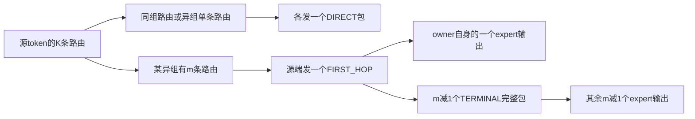

> 本文保留旧分工分析；当前独立元数据核、固定转发与均衡搬出见 [METADATA_CORES.md](METADATA_CORES.md)。

# NDR去重dispatch执行流程

本文于2026-10-27按`kernel/ll-ndr-hns1825@1d54829`更新：核心协议10、
阶段schema3/reference schema1，跨机payload采用SO整包单WQE，FIRST_HOP仍转发完整packet。
以下按正常通信、timer OFF说明，所有下标从0开始。文中构造例子用于解释路由和计数，不是设备实测。
配套的[非去重dispatch文档](NON_DEDUP_DISPATCH_FLOW.md)保留在独立文件中。

**EP32不是无条件走本文：合法输入中仅B=M=32走非去重，其余走去重。**
一键脚本默认M=256，因此该默认容量下的所有合法EP32/B均适用本文；
显式设置B32/M32时应查非去重文档。两路径共享SO传输helper，不代表路由、任务分片和combine算法相同。
非去重文档中的历史跨机发布描述，以本文第9节和[当前SO实现](ROCE_SO_PACKET.md)为准。

去重发生在**一个源token发往同一个异组的多条expert路由之间**：源端只发一个FIRST_HOP包给
该组内某个真实目标expert，它的接收核再把完整token转发给同组其他成员。所有原始expert任务仍需
收到token，计数、q和最终展开输出行数仍按完整原始路由计算。

关键区别是：源端发包份数可以减少，但专家输出份数不减少；sourceMask只记录源端实际发送的
DIRECT和FIRST_HOP位置，FIRST_HOP原权重及成员权重另存tail，供后续combine使用。

## 1 进入去重模式的条件

定义P为EP规模，B为实际token数，M为`num_max_tokens_per_rank`：

```python
enable_dedup = (M > 32) or (P > 16 and B < 32)
```

公开LL入口的候选P为16/32/64/128/256，要求`0 < B <= M <= 256`，并满足其余布局、UB和会话条件。

| P | B | M | 结果 |
|---:|---:|---:|---|
| 16 | 2 | 256 | 去重，由M>32触发 |
| 16 | 2 | 2 | 非去重 |
| 32 | 8 | 256 | 去重 |
| 32 | 8 | 8 | 仍去重，由P>16且B<32触发 |
| 32 | 31 | 32 | 去重，由B<32触发 |
| 32 | 32 | 32 | 非去重 |
| 32 | 32 | 256 | 去重 |
| 32 | 33 | 33 | 去重，由M>32触发 |
| 32 | 256 | 256 | 去重 |

这个判定不读取backend。`M`不是实际发送token数；数据分片、q和工作区中每expert/source的槽数使用B。
EP32非去重要求M≤32且B≥32，结合合法输入B≤M，只有B=M=32这一种情况。

逻辑去重组G由tiling选择：P=16时G4，P>16时G16。物理机界另按16个连续rank划分：

```text
logical_group(rank) = rank // G
physical_host(rank) = rank // 16
```

EP16/G4的异组仍在同一物理机，FIRST_HOP和relay都是MTE；EP32/G16的两个逻辑组恰好对应两台机器。
后文的“同组/异组”均指逻辑G，不直接表示是否跨机。

输入采用合法expert ID、每个token内top-k专家不重复的约定。Host准入不扫描ID合法性或唯一性；
可选精确接收行数计算会读取路由。保留旧q特殊规则不代表重复expert属于支持输入。

源码：[模式判定](../../csrc/kernels/dispatch/low_latency/common/ep_memory_server_dedup_mode.h)、
[逻辑组与物理机界](../../csrc/kernels/dispatch/low_latency/common/ll_group_policy.h)。

## 2 三类专家接收角色

| 角色 | 数值 | 来源 | 本地任务 |
|---|---:|---|---|
| DIRECT | 1 | 源端直接发送 | 写出当前expert的token和源token/k信息 |
| FIRST_HOP | 2 | 源端为异组多条路由选出的首跳 | 本地写出一个expert任务，同时转发给tail中的其他成员 |
| TERMINAL | 3 | FIRST_HOP接收核转发 | 写出当前expert任务，不再转发；记录物理slot供combine暂存 |

FIRST_HOP目标本身就是一个真实expert，不能把它理解为仅收发、不参与专家计算的专用网关。
同一张卡可以同时接收FIRST_HOP、DIRECT和TERMINAL，它们属于不同输出行。



设源token有a条同组路由，第g个异组有m_g条路由，则：

```text
DIRECT源包数 = a + 异组中m_g=1的组数
FIRST_HOP源包数 = 异组中m_g>=2的组数
源包数 = a + 有路由的异组数
relay包数 = sum(max(m_g-1,0))
源包数 + relay包数 = K
```

同组的多条路由仍逐条DIRECT；异组单条也直接DIRECT。两个成员落在同一目标rank上，只要expert不同，
仍是两个专家任务，不能合并最终输出行。

源码：[角色定义](../../csrc/kernels/dispatch/low_latency/common/ep_memory_server_dedup_protocol.h)。

## 3 Host入口和每核整体流程

公开入口为：

```text
ElasticBuffer.dispatch
  → _low_latency_plan / _dispatch_low_latency
  → native.dispatch_low_latency
  → dispatch_server_dedup_kernel_do_v2
  → 单个格式与G对应的kernel
  → DispatchMemoryServerDedupKernel.Init / Process
```

普通Python输入为BF16、FP16，或预量化E4M3FN FP8加scales。INT64路由在native调用前转为INT32。
公开FP8路径搬运已有payload和scale，不在这个dispatch调用中重新量化；内部其他格式特化仍有原量化代码。
14个编译特化不是14个同时启动的task。

实际AIV数C按当前设备查询，发送/接收各占一半：S=R=C/2。本文例子使用56核，即S28/R28。

```python
def process_one_core(core):
    magic = rotate_this_core_local_bank()
    counts.init(B, K, E, magic)
    init_sender_or_receiver(enable_dedup=True)

    counts.send_counts_for_this_core()
    if core < S:
        sender.send_with_dedup()
    else:
        counts.receive_count_snapshot()
        counts.calculate_and_publish_prefix()
        counts.wait_prefix_ready()
        PIPE_ALL()                      # count UB复用边界
        receiver.receive_and_forward()
    counts.finish()
```

各核独立推进。某发送核完成自己的CountSend后即可发送；它不等待所有接收核完成prefix。
没有“全rank先完成所有FIRST_HOP”的统一屏障。不同核之间不能拼出一个固定的全局发包次序。
CalcCumsum之后的CompleteCumsum等待本rank前缀就绪，随后PIPE_ALL保护本地count UB复用；
这里没有统一等待全部payload RDMA完成的Quiet。进入Receiver后仍需逐批检查packet flags。

源码：[Host选择与launch](../../csrc/ops/low_latency.cpp)、
[kernel.Process](../../csrc/kernels/dispatch/low_latency/dispatch_server_dedup_kernel.h)。

## 4 计数和prefix为什么仍按全部路由计算

记每rank本地expert数L=E/P。对目标rank d：

```python
record = local_expert * P + source
C[record] = 原始路由中该source发往该expert的次数
prefix[record] = sum(C[0:record+1])
T = prefix[E-1]                          # 本rank有效输出行数
```

一个FIRST_HOP包含m个expert任务，计数仍包含m条路由，不是1条源包。Receiver因此会同时为owner包
和将来的TERMINAL包建立任务。把计数改成源包数，会丢掉成员输出行并破坏接收布局。

计数实现不接收`enableDedup`。通用CountSend按全局expert编号分工，B<512用全部C核、否则用后R核；
公开LL的B≤256，使用全部C核的分工。零计数也要发布。

| 场景 | 计数控制路径 |
|---|---|
| EP16、RDMA模式 | 原source/expert记录，全为机内MTE，含self和零计数 |
| EP32、RDMA且B*K≤8192 | core0向`rank^16`交换完整ID表；计数核重建自身和配对source的本物理机expert计数，并在机内发布 |
| EP64及以上、RDMA | 原source生成全域计数，packed frame；机内MTE、跨机RDMA body+commit |
| 显式MTE | 原计数记录路径，不启用RDMA配对控制 |

EP32配对控制仍为每rank两次put和两次quiet，没有路由消费ACK。**配对控制peer不一定是payload首跳peer**。
例子B中rank0交换路由的peer是16，payload首跳却是20。
协议10的SO优化目前只合并payload，路由body与commit仍在独立区域；计数frame的独立commit也未合并。
不能把下文payload一次put的数量套到控制消息上。

各接收核对逻辑计数快照做片内prefix和subtotal，再加之前片段总和。当前只发布一份共享只读GM prefix；
`send_counts`保存相同累计前缀。prefix-ready保留NDR的R×R矩阵容量，实际生产核为`min(E,R)`。
各消费者等待并清自己的ready行，然后读取prefix；不要替换成其他分支的ready协议。

源码：[计数选择与发送](../../csrc/kernels/dispatch/low_latency/device/dispatch_server_dedup_counts.h)、
[prefix发布](../../csrc/kernels/dispatch/low_latency/device/dispatch_server_dedup_counts.h)、
[配对路由说明](PAIRED_ROUTE_EXCHANGE.md)。

## 5 Sender按token分片并预计算q

去重发送核按token分片，同一token的所有路由由同一发送核分类：

```python
base, extra = divmod(B, S)
token_start = core * base + min(core, extra)
token_count = base + (1 if core < extra else 0)
```

这与非去重按B*K展平路由切分packet所有权不同。B8/S28时，仅core0…7各有一个token，其他发送核
没有payload任务；它们仍可能执行本核的计数工作。

有任务发送核加载完整B*K原始ID表，q按原顺序计算：

```python
# 语义版。实际复用原qDst/qSub/qWork，不按此代码新增UB。
seen = zero_counts_by_expert()
for i in range(B*K):
    expert = ids[i]
    Q[i] = 0 if i < K else seen[expert]
    seen[expert] += 1
```

当前保留首token各q=0的规则；在同token专家不重复的约定下，q就是此source中该expert此前出现的次数。
首跳选择、DIRECT轮转和relay次序都不能重新编号q。B1不需要统计，q表直接全0。

输入缓存只属于当前核，缓存最近token的body；命中时用V→S依赖保护上一次pack读取，再改本包Scalar尾部。
cache miss保留TQue出队及MTE2→S或量化后的V→S依赖。源packet仍各自重新填header、打包和发送。

源码：[Sender初始化](../../csrc/kernels/dispatch/low_latency/device/dispatch_server_dedup_send.h)、
[q实现](../../csrc/kernels/dispatch/low_latency/common/ll_sender_route_plan.h)、
[输入复用](../../csrc/kernels/dispatch/low_latency/common/ll_sender_input_reuse.h)。

## 6 Classify怎样形成DIRECT和FIRST_HOP

对本核的每个token，按原始k从小到大遍历。令`own_group=source_rank//G`，每个expert对应
`destination=expert//L`、`group=destination//G`。

```python
direct_mask = 0
seen = {}                 # 异组首次命中的k
grouped = {}              # 异组对应的FIRST_HOP列表下标
first_hop_masks = []

for k in range(K):
    group = destination_rank(ids[t,k]) // G
    if group == own_group:
        direct_mask |= bit(k)
    elif group not in seen:
        seen[group] = k
        direct_mask |= bit(k)          # 暂按单条DIRECT处理
    elif group not in grouped:
        first_k = seen[group]
        direct_mask &= ~bit(first_k)   # 第二条到来，撤销第一条DIRECT
        grouped[group] = len(first_hop_masks)
        first_hop_masks.append(bit(first_k) | bit(k))
    else:
        first_hop_masks[grouped[group]] |= bit(k)
```

FIRST_HOP列表在异组**第二次命中时**建立，不按group编号排序，也不是第一次命中的顺序。
例如原k对应组序`[g2,g1,g1,g2]`且两组都不是own_group，列表先建立g1，再建立g2。

分类按expert交付条数计数。同一异组的两个expert即使在同一张卡，也会形成FIRST_HOP加一个成员；
同组路由则无论多少条都保持DIRECT。

源码：[Classify](../../csrc/kernels/dispatch/low_latency/device/dispatch_server_dedup_send.h)。

## 7 如何选择首跳expert和安排发送顺序

### 7.1 首跳选择

通常取该FIRST_HOP mask中最小的k，即原路由里最早的真实目标expert。
仅当`P=32 && G=16 && backend=rdma`时，启用四卡fullmesh子组策略：

1. 把远端物理机的16个rank看作四个连续四卡子组。
2. 在同一次Classify扫描中统计各子组实际命中的expert条数。
3. 选条数最多的子组；并列时选最早原k所在子组。
4. 在获选子组内选最早原k对应的真实expert作为owner。

这四卡子组是G16内部的选owner策略，不是把本次tiling改成G4；计数按expert条数，不是不同卡数。
EP32只有一个异G16组，因此`meshFirstK`对应唯一可能的异组FIRST_HOP。其他域继续逐mask取最小k。

### 7.2 FIRST_HOP优先及DIRECT轮转

每核先遍历本核所有token，提交它们的FIRST_HOP，并缓存DIRECT任务。然后才按目标组遍历DIRECT。
本核token原顺序不变；各token的FIRST_HOP列表轮转相位为：

```text
phase = source_rank % G + sender_core + global_token_id
scheduled_index = (ordinal + phase) % first_hop_count
```

DIRECT使用`LlDirectGroupOrder`，相位为`source_rank%G + sender_core`；每组内保持原token/k顺序。
大域仍保留已有的两半组交错策略。packet序号和输出lane环贯穿这两个阶段，不在阶段边界新增排空。

```python
for t in owned_tokens:
    direct_mask, first_hop_masks = classify(t)
    source_mask = direct_mask
    for mask in rotated_first_hop_masks(t):
        first_k = choose_real_owner(mask)
        emit(t, first_k, Q[t*K+first_k], mask)
        source_mask |= bit(first_k)
        source_weights[t,first_k] = 1.0
    cache_direct_tasks(t, direct_mask)       # 原k升序
    source_mask_out[t] = source_mask

for group in direct_group_order():
    for t,k in stable_direct_tasks[group]:
        emit(t, k, Q[t*K+k], mask=0)
        source_weights[t,k] = original_weights[t,k]

release_cached_input_if_held()
flush_remaining_RDMA_batch_at_existing_reuse_boundary()
finish_lanes_and_publish_source_metadata()
```

sourceMask覆盖每个DIRECT和每个FIRST_HOP owner；其余member位为0。
sourceWeights只有mask为1的位置有消费语义：DIRECT为原权重，FIRST_HOP为1；其余位置未定义，不能当成0。

源码：[SendWithDedup](../../csrc/kernels/dispatch/low_latency/device/dispatch_server_dedup_send.h)、
[fullmesh选择](../../csrc/kernels/dispatch/low_latency/common/ll_fullmesh_first_hop.h)、
[发送轮转](../../csrc/kernels/dispatch/low_latency/common/ll_send_order.h)。

## 8 每个packet携带什么

所有packet都保留完整token、可选scale、32B header和K个8B的tail块。去重不会把成员改成32B引用。

### 8.1 Header和tail

```text
header = [original_source_rank, source_token_id, original_k, role]
```

DIRECT的`original_k`是该DIRECT路由位置；FIRST_HOP存owner的`first_k`。
expert和q用于选择物理槽，未放进这四项header。

| 包 | tail block0 | 后续有效tail块 |
|---|---|---|
| 去重模式DIRECT | `[N=0, 原w_k的位模式]` | 无member |
| FIRST_HOP | `[N=成员数, owner原权重的位模式]` | `[expert \| (q<<16), member原权重的位模式]` |

DIRECT在去重模式下仍会写block0的原权重；这与非去重的提前返回分支不同。
FIRST_HOP有效块为0…N，N≤K−1；剩余块不属于有效成员，不能根据残值解释路由。
`relay_read_index`的第二列以INT32存储FP32位模式，表格中的小数仅为解释其数值。

扫描全部原k，但只写**当前FIRST_HOP mask中除owner以外的成员**，按原k升序保存。
若fullmesh把owner从k1改成k2，该mask中的k1仍必须进入tail，不能从`first_k+1`开始扫描。

### 8.2 角色与wire布局标记是两件事

wire每512B由480B payload和32B flags组成，每flag块有8个FP32值。第一块的第一个flag另携带布局hint：

| 源包/转发包 | header角色 | marker | 正常接收加载方式 |
|---|---:|---:|---|
| DIRECT | 1 | Compact=1.0 | 跳过flags，压紧480B片段 |
| FIRST_HOP | 2 | KeepFlags=1.5 | 完整读取wire，保留flags以便转发 |
| TERMINAL转发 | 3 | Compact=1.0 | 跳过flags，压紧payload |

若包有n个wire块，flag和为`8*n`表示Compact就绪，为`8*n+0.5`表示KeepFlags就绪。
因此Compact不等同于DIRECT；TERMINAL同样是Compact。

源码：[FillTail](../../csrc/kernels/dispatch/low_latency/device/dispatch_server_dedup_send.h)、
[角色与tail格式](../../csrc/kernels/dispatch/low_latency/common/ep_memory_server_dedup_protocol.h)、
[布局hint](../../csrc/kernels/common/ep_packet_receive_layout.h)。

## 9 源端MTE与RDMA的实际发布

目标slot始终由原始source s、目标rank d、本地expert编号l、q计算：

```python
slot = (((s + d) % P) * L + l) * B + q
offset = bank_offset + dispatch_offset_within_bank + slot * tokenStride
```

Init后的`data_.dispatchOffset`已包含bank，调用时不能再重复加bank。
同物理机和self目的地走MTE；跨物理机走每核独占QP的RDMA batch。

跨机batch把完整wire复制到注册GM，等待MTE3_S后，一次Put发送整个packet。
packet的最后32B已经是flag：利用用户给出的WQE尾片SO及片内保序保证，接收端原有完整flag检查
包含该尾flag，因而不会在前面的payload未到达时就绪。内部flag位置和Compact/KeepFlags标记不变。
不再保存额外首gate副本、清首gate或单独发送gate。容量为`min(8, floor(128KiB/tokenStride))`。

```python
enqueue(packet):
    stage_complete_wire_to_private_GM_slot()
    wait_MTE3_to_Scalar()
    put_whole_packet_in_one_WQE()        # 包含原有末尾32B flag
    if full:
        flush()

flush():
    quiet_distinct_peers_once()          # 完成后才可复用GM源槽
    release_batch_slots()
```

FIRST_HOP的首flag仍为marker=1.5，DIRECT为1.0。接收端保留全部块的flag检查，不能改成只查首flag。
尾片SO只用于同一WQE，不推导跨WQE、跨QP或跨peer的全局顺序。
Quiet负责发送源GM和CQ退休；接收端数据就绪可能早于Quiet返回，也不代表接收者已经消费完毕。

**优先提交FIRST_HOP不代表远端立即就绪，但不再等尾批Flush才发布gate。**
B8例子中，每sender提交一个完整跨机FH后继续机内DIRECT；远端只要整个消息和目标prefix就绪即可消费。
尾批仍在已有PIPE_ALL保护后Flush，确保网卡不再读取GM源槽。它不再承担额外flag发布。

正常dispatch跨机走`SendPacket → rdmaBatch_.Enqueue`，不走`Packet()`的同步RDMA分支；
机内发送和同组relay调用`Packet()`的MTE分支。当前同步RDMA Packet主要用于跨机combine，
也已改成整包一次Put＋一次Quiet。完整范围见[SO整包发布](ROCE_SO_PACKET.md)。

源码：[SendPacket](../../csrc/kernels/dispatch/low_latency/device/dispatch_server_dedup_send.h)、
[batch](../../csrc/kernels/dispatch/low_latency/device/ll_dispatch_rdma_batch.h)、
[Sender尾批](../../csrc/kernels/dispatch/low_latency/device/dispatch_server_dedup_send.h)。

## 10 Receiver如何消费并转发FIRST_HOP

Receiver根据完整prefix建立实际T个输出行的分片：`begin=floor(r*T/R)`、`end=floor((r+1)*T/R)`。
记录`a=l*P+s`中的第q条数据写`row=prefix[a-1]+q`（a=0时前缀起点为0），同时保留上述真实slot。

稳定任务j决定`row=begin+j`和slot；pending表只用于轮询，可以交换末项填洞。每次最多probe16项，
只预取已ready任务，lane数受可用UB、8和本核任务数共同限制。到达次序不决定输出行。

### 10.1 必须先保存本地角色

```python
wait_this_lane_MTE2_to_Scalar()
role = incoming_header.role
saved_type = role
if role == TERMINAL:
    saved_destination = [this_packet_physical_slot, UINT32_MAX, UINT32_MAX]
else:
    saved_destination = incoming_header[0:3]

first_hop = (role == FIRST_HOP)
if first_hop:
    UB_header.role = TERMINAL
    UB_wire.marker = Compact

publish_Scalar_to_MTE3_dependency()
wait_this_lane_MTE2_to_MTE3()
write_local_hidden_and_scales(using_original_keepFlags)
write(saved_type, saved_destination)

if first_hop:
    issue_copy_of_all_K_tail_blocks_to_relay_read_index()
    for member in tail_original_k_order:
        forward_same_wire_to(member.expert, member.q, original_source)

publish_lane_MTE3_to_MTE2()
```

owner自己的type已经保存为2，因此后来把转发UB header改成3，不会把owner输出误写成TERMINAL。
owner的destinationIndex仍为`[source,token,first_k]`。

`keepFlags`来自入站probe，是这次UB加载布局的快照。即使准备转发时把marker改成Compact，
owner仍必须按原keepFlags提取自己的hidden/scales，跳过wire中间的flag块，不能把flag当数据输出。

relayReadIndex保存和转发均是MTE3提交；代码没有先单独等待tail复制完成再逐成员转发。
当前lane的依赖保护这些读取，后续复用才等待对应事件。

### 10.2 转发仍使用原始source

转发目标由member的expert确定，q取tail中该member的原q，slot公式中的s仍是最初source，不能换成owner。
转发header前三项保留原source/token/first_k；只改角色。TERMINAL因而不能把这个first_k当自己的原k。

成员在owner同rank时也执行一次Packet写入独立槽，由普通Receiver消费；没有直接写展开输出的捷径。
两个member在同rank时也各发一包。成员都位于owner逻辑组内，而G4/G16都不跨16卡物理机界，
所以NDR的relay是机内MTE。

TERMINAL写出的metadata为：

```text
token_type = 3
destination_index = [physical_slot, 0xffffffff, 0xffffffff]
```

INT32 tensor视图中的两个哨兵是`-1`。这个slot用于后续combine放置专家输出stage，不是output row。
TERMINAL不再转发，也不写一份有意义的relayReadIndex。

### 10.3 结束与清理

pending清空后，处理各lane归还依赖，按稳定slot表发起本核packet flags清理；最终PIPE_ALL确认
输出、relay和清理完成。这里不新增Scalar完成屏障。payload保留，flags清零供后续bank复用。

源码：[任务构造](../../csrc/kernels/dispatch/low_latency/device/dispatch_server_dedup_recv.h)、
[role快照](../../csrc/kernels/dispatch/low_latency/device/dispatch_server_dedup_receive_packet.h)、
[FIRST_HOP消费和转发](../../csrc/kernels/dispatch/low_latency/device/dispatch_server_dedup_recv.h)。

## 11 例子A EP16内的G4去重

配置：P16、B2/M256、H3584、K4、E32、G4、C56/S28/R28，BF16输入。source0的路由和权重为：

| token | expert IDs按k排列 | 原始weights |
|---:|---|---|
| 0 | `[2,8,11,10]` | `[0.10,0.20,0.30,0.40]` |
| 1 | `[3,8,10,18]` | `[0.15,0.25,0.35,0.25]` |

为了使计数与行号完全可复现，其余source r=1…15的两个token都选：

```python
base = 8 * (r // 4)
ids[r,t] = [base + (2*(r % 4)+j) % 8 for j in range(4)]
```

这些source的全部路由都在各自own G4组内，因此它们没有FIRST_HOP，各发8个DIRECT。
这些source的权重统一取`[.25,.25,.25,.25]`；hidden任取满足shape和dtype的向量，下面跟踪路由及metadata。

### 11.1 source0的分类

source0属于组0（rank0…3）。expert2/3在rank1，属于同组；expert8在rank4，expert10/11在rank5，
均属组1；expert18在rank9，属组2。

| token | 异组mask | directMask | owner | sourceMask | 有效sourceWeights |
|---:|---|---|---|---|---|
| 0 | k1/k2/k3，`0xe` | k0，`0x1` | k1/e8/rank4 | `0x3` | `[.10,1,X,X]` |
| 1 | k1/k2，`0x6` | k0/k3，`0x9` | k1/e8/rank4 | `0xb` | `[.15,1,X,.25]` |

X为未定义、不会被sourceMask选中的位置，不是0。
G4模式不启用EP32 fullmesh策略，owner取该组最小k。token1的expert18是异组单条，仍为DIRECT。

B2/S28时core0负责整个token0，core1负责整个token1。按实际轮转，两核各自的提交次序为：

```text
core0: FH(t0,k1,e8) → DIRECT(t0,k0,e2)
core1: FH(t1,k1,e8) → DIRECT(t1,k3,e18) → DIRECT(t1,k0,e3)
```

core1的DIRECT组序为1、2、3、0，故组2的k3先于组0的k0。两核彼此独立，不能把两行拼成全局时间线。
每核一直使用同一个token，可复用输入body，但分别产生2个和3个完整packet。

### 11.2 FIRST_HOP tail

token0各expert首次出现，q均为0。token1的e8/e10此前出现过，q=1；e3/e18为0。

| token | header | tail block0 | tail block1 | tail block2 |
|---:|---|---|---|---|
| 0 | `[0,0,1,2]` | `[N=2,.20]` | `[e11/q0,.30]` | `[e10/q0,.40]` |
| 1 | `[0,1,1,2]` | `[N=1,.25]` | `[e10/q1,.35]` | 无效 |

token1的member index实际为`10 | (1<<16) = 65546`。
token0成员顺序是原k2的e11，然后原k3的e10，不能按expert数值排序。

### 11.3 真实slot与最终输出行

下表覆盖source0全部8条原始路由。每条最终都成为一个expert输出行：

| t/k | expert | 最终rank | output row | GM slot | 本地type | destinationIndex |
|---|---:|---:|---:|---:|---|---|
| 0/0 | 2 | 1 | 0 | 4 | DIRECT=1 | `[0,0,0]` |
| 0/1 | 8 | 4 | 0 | 16 | FIRST_HOP=2 | `[0,0,1]` |
| 0/2 | 11 | 5 | 6 | 22 | TERMINAL=3 | `[22,-1,-1]` |
| 0/3 | 10 | 5 | 0 | 20 | TERMINAL=3 | `[20,-1,-1]` |
| 1/0 | 3 | 1 | 3 | 6 | DIRECT=1 | `[0,1,0]` |
| 1/1 | 8 | 4 | 1 | 17 | FIRST_HOP=2 | `[0,1,1]` |
| 1/2 | 10 | 5 | 1 | 21 | TERMINAL=3 | `[21,-1,-1]` |
| 1/3 | 18 | 9 | 0 | 36 | DIRECT=1 | `[0,1,3]` |

例如rank4处理token0的FH时，本地先保存type2和`[0,0,1]`；把待转发UB header改为type3，
再按tail先提交e11到rank5/slot22，后提交e10到rank5/slot20。前者写output row6，后者写row0，
输出位置不按提交先后生成。

转发e10必须用原source0计算slot20。若错用owner rank4当source，会得到slot36，覆盖其他source的
区域，并让正确slot20缺包。

### 11.4 计数、交付数与流量范围

| 接收rank | 本地expert实际计数 | T |
|---:|---|---:|
| 1 | e2=3，e3=3 | 6 |
| 4 | e8=6，e9=4 | 10 |
| 5 | e10=6，e11=5 | 11 |
| 9 | e18=5，e19=4 | 9 |

所有rank的T为：

```text
[4,6,8,8,10,11,8,8,8,9,8,8,8,8,8,8]
总和 = 128 = P*B*K
```

source0发2个FH、3个DIRECT共5个源包；rank4再发3个relay包，完成8个原始expert任务。
全作业`15*8+5=125`个源包，加3个relay，仍为128次expert交付。
payload搬运中有68个跨卡MTE和60个self写，均在同一物理机，没有跨机ROCE。

此例去重减少source0跨逻辑组的原始6次发送为3次，再由组内relay补齐3次交付。
它改变了搬运分布，不能把“源包少3个”直接写成全作业总搬运少3个。

## 12 例子B EP32 fullmesh首跳与同卡成员

配置：P32、B8/M256、H3584、K8、E384、G16、C56/S28/R28，RDMA后端，预量化FP8输入。
source0的全部8个token都使用以下路由和权重：

| k | expert | 目标rank | 原权重 | 分类后的最终角色 |
|---:|---:|---:|---:|---|
| 0 | 12 | 1 | .05 | DIRECT |
| 1 | 192 | 16 | .10 | TERMINAL，由rank20转发 |
| 2 | 240 | 20 | .15 | FIRST_HOP owner |
| 3 | 252 | 21 | .20 | TERMINAL |
| 4 | 264 | 22 | .10 | TERMINAL |
| 5 | 13 | 1 | .10 | DIRECT |
| 6 | 241 | 20 | .20 | 同卡TERMINAL |
| 7 | 14 | 1 | .10 | DIRECT |

其余source r=1…31的全部8个token都选本rank的expert`12*r … 12*r+7`，所以它们均为self DIRECT。
这些source每个token的权重均取8个`1/8`。

### 12.1 为什么owner不是最早的远端k1

source0的同G16路由是k0、k5、k7；异G16有k1、k2、k3、k4、k6，全部属于rank16…31。
四卡子组统计如下：

| 四卡子组 | 命中的expert条数 | 原k |
|---|---:|---|
| rank16…19 | 1 | k1 |
| rank20…23 | 4 | k2、k3、k4、k6 |
| rank24…27 | 0 | 无 |
| rank28…31 | 0 | 无 |

rank20…23有4条交付，虽然只涉及rank20/21/22三张卡。选这个子组中最早的k2/e240作为owner。
这里的四卡子组没有改变G16，也没有引入一个非目标expert网关。

```text
FIRST_HOP mask = 0x5e  # k1,2,3,4,6
DIRECT mask   = 0xa1  # k0,5,7
sourceMask    = 0xa5  # k0,2,5,7
sourceWeights有效值 = [.05, X, 1, X, X, .10, X, .10]
```

### 12.2 t3的tail与真实槽位

所有token的路由相同且expert各不重复，因此每个expert在token t处的q=t。
token3的FH header为`[0,3,2,2]`，tail为：

| tail block | index字段 | 原权重 |
|---:|---|---:|
| 0 | N=4 | .15 |
| 1 | `192 \| (3<<16)` | .10 |
| 2 | `252 \| (3<<16)` | .20 |
| 3 | `264 \| (3<<16)` | .10 |
| 4 | `241 \| (3<<16)` | .20 |
| 5…7 | 无效 | 无效 |

member次序为原k1、k3、k4、k6。早于owner k2的k1仍存在。
rank20最后转发的member是自己卡上的expert241；它仍产生一个TERMINAL packet。

| t3路由 | 目标rank | output row | GM slot | 本地destinationIndex |
|---|---:|---:|---:|---|
| k0/e12 DIRECT | 1 | 3 | 99 | `[0,3,0]` |
| k5/e13 DIRECT | 1 | 19 | 107 | `[0,3,5]` |
| k7/e14 DIRECT | 1 | 35 | 115 | `[0,3,7]` |
| k2/e240 FIRST_HOP | 20 | 3 | 1923 | `[0,3,2]` |
| k1/e192 TERMINAL | 16 | 3 | 1539 | `[1539,-1,-1]` |
| k3/e252 TERMINAL | 21 | 3 | 2019 | `[2019,-1,-1]` |
| k4/e264 TERMINAL | 22 | 3 | 2115 | `[2115,-1,-1]` |
| k6/e241 TERMINAL | 20 | 19 | 1931 | `[1931,-1,-1]` |

rank20的expert240有8条source0 FH和8条source20 DIRECT，共16行；expert241同样16行，
其中source0为TERMINAL。因此FH row3和同卡Terminal row19属于不同任务。
rank20总T=80：64条自身DIRECT、8条source0 FH、8条source0 TERMINAL。

### 12.3 实际提交次序与调用量

core0…7各负责一个token，均按本核次序执行：

```text
FH k2/e240 → DIRECT k0/e12 → DIRECT k5/e13 → DIRECT k7/e14 → 尾批Flush
```

前面的FH一次提交完整RDMA消息，尾flag随同一WQE到达；尾批Flush只等待源槽/CQ完成。
三个DIRECT都在本机rank1，走MTE。
远端owner收到ready FH后按tail顺序转发到rank16、21、22、20，最后一次是self MTE。

对source0的8个token：

```text
源packet = 8 * (1 FH + 3 DIRECT) = 32
relay    = 8 * 4                = 32
expert交付 = 64                 = B*K

跨机payload：8个FH，每个发送核1次Put＋尾批1次Quiet
source0 payload RDMA = 8 Put、8 Quiet
加配对路由控制       = 10 Put、10 Quiet
```

payload首跳peer为20，配对控制peer为16。payload使用core0…7对应的peer20 QP0…7；
控制使用core0对应的peer16 QP0。不同peer的同编号QP不是同一个完成点，也不表示会话只配置8个QP。

每个FP8 wire为4096B（8个512B块），逻辑payloadBytes=3808B、packedPayloadBytes=3840B，
其中hidden3584B、scales112B、header逻辑offset3712、tail逻辑offset3744。
不再单独提交32B gate，8个FH实际提交`8*4096=32768B`，另有路由表256B和commit4B，合计33028B。
这些是LL调用字节和次数，不是NIC含头线速字节或以太网包数。

全作业2016个源packet加32个relay，完成2048条原始路由。其中payload有8个跨机packet、
48个跨卡机内MTE、1992个self写。对source0自身，逐expert跨机发送本需5包/token，去重后是1包/token，
其余4条在目标物理机内完成；这才是本例跨机流量减少的位置。

## 13 权重怎样在combine中还原

dispatch本身只搬hidden/scales，不乘这些权重。为解释sourceMask和tail，需要看后续的三种处理：

| 角色 | combine中的处理 |
|---|---|
| DIRECT | 专家输出直接返回源rank的token/k槽；源端乘sourceWeights中的原权重 |
| TERMINAL | 把专家输出写到本rank对称stage的physical slot，供owner读取，不单独返回源rank |
| FIRST_HOP | 读取自身专家输出和tail指定的各成员stage，乘tail中的原权重求partial，返回源token的first_k槽 |

TERMINAL stage按physical slot放置，不按压紧output row。owner按原source及member expert/q反查相同slot；
同卡成员也走相同stage读取接口。owner自己的expert输出直接从本地对应row读取，不先绕一遍stage。

例子B中，令z_k为token经第k条路由的专家输出，数学贡献为：

```text
p = .10*z1 + .15*z2 + .20*z3 + .10*z4 + .20*z6
y = .05*z0 + 1*p + .10*z5 + .10*z7
```

owner原权重`.15`已经放在tail block0，所以sourceWeights的k2写1，不能再乘`.15`。
例如取z_k=k+1，理想实数表达式得到p=3.35、y=4.80，仅用于说明权重归属。

实际代码先按**owner k2，然后member k1、k3、k4、k6**做FP32累计，将partial取整为BF16/FP16后返回；
源端再按mask选中的k0、k2、k5、k7累计并最终取整。因此这里是代数等价，不能声称与平铺8项求和
逐位相同。当前优化保持原有这条数值路径。

源码：[TERMINAL暂存](../../csrc/kernels/combine/low_latency/combine_server_dedup_kernel.h)、
[member读取与归约](../../csrc/kernels/combine/low_latency/combine_server_dedup_partial.h)、
[源端加权](../../csrc/kernels/combine/low_latency/combine_server_dedup_source_aggregate.h)。

## 14 输出和容量的有效范围

| 字段 | 去重模式的有效含义 |
|---|---|
| out、可选scales | 前T行对应全部原始expert任务；DIRECT、FH、TERMINAL都贡献行 |
| token_type | 前T行为1/2/3，表示该输出行的本地角色 |
| destination_index | DIRECT/FH为原source/token/k；TERMINAL为slot和两个-1 |
| relay_read_index | 只有FH行有效；块0…N是owner/member的原权重与expert/q |
| source_mask | 每个源token的有效回传槽位，选择DIRECT和各FH first_k |
| source_weights | 仅mask命中位有效；DIRECT保留原权重，FH为1 |
| send_counts | 目标rank的E项累计接收prefix，末值T，非源包计数 |

元数据容量`C_B=P*B*min(K,L)`，物理dispatch槽容量`E*B`。
公开`do_cpu_sync=False`时payload返回容量`C_M=P*M*min(K,L)`，只有前T行已写入；
精确行数模式通过Host计数后返回前T行view，设备内部count/prefix仍执行。
NDR RDMA会话要求已有HCCL ProcessGroup。

| 例子 | C_B | C_M | 物理packet槽容量 | 所示实际T |
|---|---:|---:|---:|---|
| EP16/B2/M256/K4/E32 | 64 | 8192 | 64 | rank4为10，rank5为11 |
| EP32/B8/M256/K8/E384 | 2048 | 65536 | 3072 | rank20为80 |

容量尾部及无效metadata字段不能解释为全零。内部expert计数scratch仍由kernel写，但公开handle相应
count tensor属性保持None；实际T以send_counts末值为准。
当前FP8测试的后半段是BF16专家输出/combine，不能称为原生FP8 combine。

源码：[Host分配与handle](../../deep_ep/buffers/elastic.py)、
[布局容量](../../csrc/kernels/dispatch/low_latency/common/ep_memory_server_dedup_layout.h)。

## 15 必须保持的顺序和阅读要点

1. q和计数都来自完整原始路由；FIRST_HOP不会减少最终expert行数。
2. FIRST_HOP列表按异组第二次命中建立，然后轮转；不能任意排序。
3. fullmesh改变owner时，仍扫描全部原k，从本FIRST_HOP mask选取成员，包含比owner更早的成员。
4. owner先保存type2和源坐标，再把待转发UB改为TERMINAL；本地输出角色不变。
5. 修改marker后仍按原keepFlags解释owner当前UB布局。
6. 转发和combine member寻址都用原source，不用中转rank；self member仍占独立槽。
7. FIRST_HOP优先是每核提交顺序，远端消费需整个packet尾flag和prefix就绪，不再等待独立gate发布。
8. 保留MTE、lane、源GM暂存和窗口复用依赖；SO不替代源完成quiet，也没有新增路由消费ACK。
9. 正式LL不读取GetSystemCycle，诊断timer和用户保留的SDK内部机制有各自范围。
10. 不把sourceMask之外的权重、非FH的relayReadIndex或容量尾部当作有效结果。

源码入口索引见[KERNEL_MAP](../ll_probe/KERNEL_MAP.md)，共同计数和Receiver底层流程的更长展开见
[非去重dispatch文档](NON_DEDUP_DISPATCH_FLOW.md)，本轮优化与生命周期约束见
[OVERHEAD_OPTIMIZATION](OVERHEAD_OPTIMIZATION.md)。

## 16 当前采样与打点入口

当前ST采样协议为`initial-reduce-exp100-batch-v3`：每个操作的采样批次只在开始做一次all_reduce；
预热并同步后，在进入active的profiler.step之前固定100次Exp，然后连续调用算子，循环内无采样
Exp/all_reduce。默认10预热、100采集、每rank尾50；算子内部必要复用协调保持。

独立timer/reference同样为初始all_reduce、预热、100次Exp、连续稳定调用和capture。
若perf后追加打点，则另排一次100次Exp前缀，共用perf初始all_reduce；不混入正式perf统计。
`--mode reference`只测LL dispatch、默认1轮capture，并导出29阶段逐核表；该表是核内cycle，
不能替代完整OFF profiler task时间。旧timer/reference与新采样协议的结果不可直接同条件A/B。

目前reference会在正确性多轮检查后恢复声明seed并记录实际路由指纹；perf/旧timer仍沿用最后一轮
正确性检查的路由，默认3轮时实际为声明seed+2。比较路由负载时应区分，本文构造例子不依赖随机seed。
详见[采样协议](../ll_probe/PROFILING.md)和[参考逐核表](../ll_reference_profile/README.md)。
