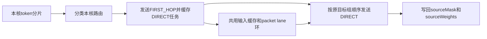
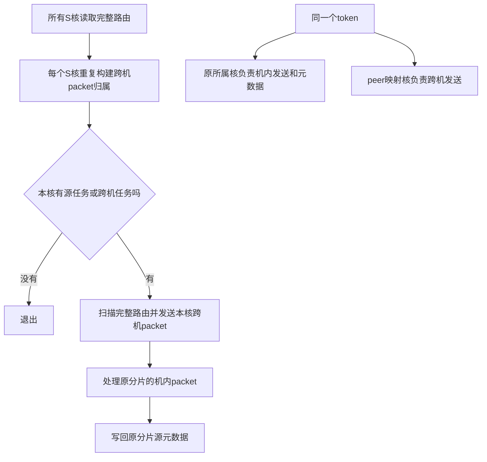
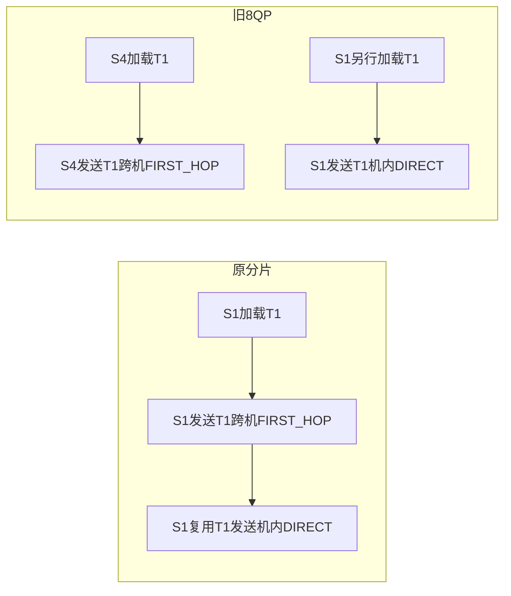
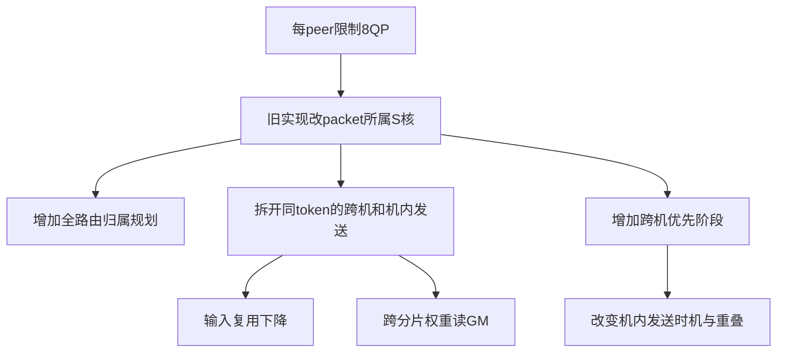

# 8QP发送调度方案复盘与重新设计议题

2026-10-28。用户反馈旧8QP实现性能严重劣化，要求重新讨论方案。本记录基于源码解释调度变化，不将示例工作量当作实测时延，也不据此认定唯一瓶颈。此次只记录分析，不实施新方案。

## 1. 版本和比较边界

| 版本 | 跨机packet分工 | 说明 |
|---|---|---|
| 原分片，当前4949234 | token/路由所属S核发送 | 已恢复；逐次Vector求q，保留路由SO |
| 旧8QP，如f52ab46 | 每peer选择8个独占S核，按该peer的packet序号轮转 | 已从当前分支撤销 |
| 解除8QP后的轮转，如7b51ad7 | 每peer的packet序号在全部S核间轮转 | 仍改变原token归属，现也已撤销 |

原始参考b50d599已经是每物理核一个QP；“取消8QP限制”不等于恢复原始调度。b50d599还启用q预计算，当前4949234使用Vector求q。不同版本也有路由SO、旧打点源码和测试负载差异，不能直接用整版本差值单独解释发送调度收益。

以下只比较调度机制。默认EP32、G16、56 AIV即28个S核；跨机只涉及两个物理机。原有去重和首跳专家选择保持。FIRST_HOP/DIRECT是业务角色，不分别等于跨机/机内；单个远端成员也可能是跨机DIRECT。

## 2. 原分片：围绕本核token组织发送

去重路径按连续token分片分工；非去重路径按展平路由分片。S核负责自己分片的FIRST_HOP、DIRECT和源元数据。各核独立推进。



- 原实现已经优先发送FIRST_HOP；不能描述为机内先发、跨机后发。
- FIRST_HOP和DIRECT之间没有新增全量完成栅栏。
- 连续发送同一个token可复用本核输入缓存；不保证跨越其他token后仍能复用。
- 无token/路由任务的核可在sender准备前较早退出。计数阶段的参与规则另算。

## 3. 旧8QP：拆分token归属和跨机packet归属

机内发送及sourceMask/sourceWeights仍由原分片核负责；跨机packet重新分配给该peer的QP拥有者。



“先跨机、后机内”是每核内部顺序，不是新增全rank统一屏障。阶段之间也不能假定全部跨机WQE已完成；原批次和quiet仍决定源退休。

关键代价：不同核不能共享彼此的UB输入缓存。网络包数量可以不增加，但输入准备次数增加。

## 4. 可复核例子：B8、K8、两个远端首跳peer

源rank0，S0～S27。T0～T7各有4个本机目标和4个远端目标；远端4个成员合并为一个FIRST_HOP。偶数token首跳peer17，奇数token首跳peer18。可用远端rank16～19构造同一4卡组，并调整首路由顺序得到上述首跳；这是解释用合法负载，不代表全部实测负载。

原分片时，T0～T7分别属于S0～S7。旧8QP映射对本例非配对peer使用：

```text
owner = ((peer - rank + world) % world * 8 + qp) % sendCores
peer17: QP0..7 -> S24 S25 S26 S27 S0 S1 S2 S3
peer18: QP0..7 -> S4  S5  S6  S7  S8 S9 S10 S11
```

固定配对peer16另有QP0归属core0的控制保护，不使用上述简单公式；本例避开该特殊peer。

| token | 首跳peer | 原分片S核/QP | 旧8QP S核/QP | 解除8QP后的轮转S核/QP |
|---|---:|---|---|---|
| T0 | 17 | S0/QP0 | S24/QP0 | S0/QP0 |
| T1 | 18 | S1/QP1 | S4/QP0 | S0/QP0 |
| T2 | 17 | S2/QP2 | S25/QP1 | S1/QP1 |
| T3 | 18 | S3/QP3 | S5/QP1 | S1/QP1 |
| T4 | 17 | S4/QP4 | S26/QP2 | S2/QP2 |
| T5 | 18 | S5/QP5 | S6/QP2 | S2/QP2 |
| T6 | 17 | S6/QP6 | S27/QP3 | S3/QP3 |
| T7 | 18 | S7/QP7 | S7/QP3 | S3/QP3 |

解除8QP后的版本用`ordinal % sendCores`分配，而每个peer的ordinal都从0开始。本例8个远端包只落到S0～S3，原分片反而使用S0～S7。“允许全部28核”不意味着当前负载会用满或均匀分布到28核。

### 输入复用的变化



本例每个token都有机内任务，且每个原分片核只有一个token。按现有连续同token缓存规则：

| 核 | 旧8QP的输入准备序列 | 次数 |
|---|---|---:|
| S0～S3 | 各自本机T0～T3 | 4 |
| S4 | 跨机T1、本机T4 | 2 |
| S5 | 跨机T3、本机T5 | 2 |
| S6 | 跨机T5、本机T6 | 2 |
| S7 | 跨机T7、本机T7，连续复用 | 1 |
| S24～S27 | 分别跨机T0/T2/T4/T6 | 4 |
| 合计 | 原分片为8次，旧8QP为15次 | 15 |

这不是时延翻倍的结论。预量化FP8主要增加输入/scale搬运及相关依赖；内部量化模式还可能重复量化。网络没有因此多发送同一份跨机packet。

解除8QP后，S0可能执行`跨机T0 → 跨机T1 → 本机T0`，最后必须重新准备T0输入。由此可见，扩大QP数量而保留新调度，不能自动恢复原输入复用。

## 5. 新增工作和可能的劣化来源

| 项目 | 原分片 | 旧8QP派生实现 |
|---|---|---|
| 小BS空核 | 可在sender准备前退出 | 为判断remote任务先参与规划 |
| 本例sender读取完整路由的核数 | 8 | 28 |
| packet归属规划 | 无 | 各S核重复计算 |
| 远端路由分类 | 在原分片流程中处理 | 规划扫描中还会扫描token的K项判断去重/首跳 |
| 发包筛选 | 遍历本核分片 | 有remote任务的核再次扫描完整路由 |
| 跨机包尾权重 | 原分片权重UB | 原始GM Scalar读取 |
| 输入复用 | 同核token缓存 | 跨核拆分，可能重复准备 |
| 发送顺序 | 原FIRST_HOP/DIRECT组顺序 | 每核新增跨机优先阶段 |
| 后续q A/B共同准备 | 原三块q scratch | 另加qPlanBuf，可能减少lane容量 |

注意：原实现也会读取完整路由来求q，不能把它描述为完全没有全表扫描。新增成本是packet归属规划及小BS原本空闲的核也参与sender准备。qPlanBuf是后续实验共同准备引入，不能说成最初8QP提交就增加了它。

顺序变化还会推迟部分本机DIRECT、改变本机接收开始时间、改变批次quiet位置和核间重叠。源码证明这些工作/顺序发生变化；哪个因素占据实测主导仍需同输入、同q算法、同UB布局的实验。不要把不同版本的reference w43当作同口径工作量：旧轮转版包含源任务加remote任务，原分片版为原分片路由任务数。

## 6. 重新讨论方案的约束

8QP是每peer的NIC队列数量约束，不天然要求改变token归属，也不天然要求跨机优先。旧实现一次引入太多额外变量，未充分隔离其成本，不应继续把这些附带改动视为8QP必要组成。



先确认：是否要求所有S核直接提交RoCE WQE，还是允许部分核生产、8个核提交？

| 候选方向，尚未决定实施 | 希望保留的性质 | 必须评估的代价 |
|---|---|---|
| 8个S核承担完整token分片 | 同token输入准备、跨机和机内发送集中在同核 | 并行度降低，其他S核怎样利用 |
| 原S核生产，8个提交核发送 | 原输入处理归属 | GM交接、ready、排队与源缓冲生命周期 |
| 多S核共享8QP | 尽量维持原分片 | SDK是否支持多生产者，或串行化开销；禁止未经证明直接core_id%8共享 |

后续方案应分别说明：token生产者、QP提交者、接收发布、源退休、槽位复用、零任务和小BS行为。不得借助SO推导跨WQE/跨QP顺序，也不能把quiet当成接收端消费确认。

验证时固定测试路由/seed、q算法、SDK、核数及OFF采样协议；区分算法工作量、UB/lane变化与QP数量。性能以完整OFF task为准；目的性打点只解释机制，不替代OFF结论。当前不实施上述候选。

## 7. 源码核对入口

- 当前原分片：[dispatch_server_dedup_send.h](../../csrc/kernels/dispatch/low_latency/device/dispatch_server_dedup_send.h)，主要看Process、SendWithDedup、SendWithoutDedup。
- 当前组顺序：[ll_send_order.h](../../csrc/kernels/dispatch/low_latency/common/ll_send_order.h)。
- 输入缓存：[ll_sender_input_reuse.h](../../csrc/kernels/dispatch/low_latency/common/ll_sender_input_reuse.h)。
- 历史8QP：用`git show f52ab46:csrc/kernels/dispatch/low_latency/common/ll_dispatch_peer_owners.h`核对映射；同提交sender的SendRemotePackets和RouteWeight核对额外扫描与GM权重读取。对应规划头文件已从当前实现删除，不要重新引入作默认路径。
- 当前运行边界与命令：[PER_CORE_QP_AB.md](PER_CORE_QP_AB.md)。
