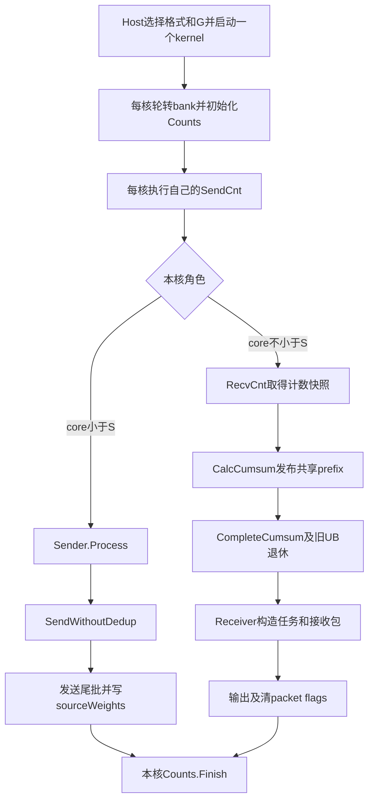

> 本文保留旧分工分析；当前独立元数据核、固定转发与均衡搬出见 [METADATA_CORES.md](METADATA_CORES.md)。

# NDR非去重dispatch执行流程

本说明对应`kernel/ll-ndr-hns1825`的源码`92cbf6823132d3753b995b9f073336f62c07bd69`，
即冗余开销优化后的核心协议9、阶段schema3版本。以正常通信、timer OFF和公开
`ElasticBuffer.dispatch`入口为主。所有下标从0开始。

非去重dispatch的核心行为是：**每条原始top-k路由发送一份完整token，直接送到该专家所在rank；
目标rank先取得完整计数前缀，再把收到的包写到按专家、source、q排列的输出行。**
同一个token即使命中同一目标rank上的多个专家，也会生成多个包。没有FIRST_HOP合包、relay转发
和源权重改写，但设备计数交换、prefix和接收清理仍然执行。

这里采用合法expert ID、每个token的top-k专家不重复的输入约定。Host准入检查tensor元数据，
不验证路由ID合法性或每token唯一性；可选的精确行数计算另会读取路由。测试入口通过
`random.sample`生成不重复专家。代码保留首token的特殊q规则，
不能据此推导同token重复expert属于支持的路由。

## 1 先判断是否真的进入非去重

记实际token数为B，`num_max_tokens_per_rank`为M，EP规模为P。当前唯一判定是：

```python
enable_dedup = (M > 32) or (P > 16 and B < 32)
non_dedup = not enable_dedup
```

公开LL入口的候选域为`P∈{16,32,64,128,256}`，要求`0 < B <= M <= 256`，
并继续满足Host布局、UB和会话校验。因此，在合法公开配置内：

- EP16：M≤32时非去重。
- EP32及以上：非去重必须同时满足M≤32、B≥32，因此是**B=M=32**。
- 当前常用的EP32、B8/M256是去重路径；改成B8/M8仍然去重。

| P | B | M | 路径 | 原因 |
|---:|---:|---:|---|---|
| 16 | 2 | 2 | 非去重 | 两个去重条件均为false |
| 16 | 8 | 32 | 非去重 | M未超过32，P未超过16 |
| 16 | 8 | 256 | 去重 | M>32 |
| 32 | 8 | 8 | 去重 | P>16且B<32 |
| 32 | 32 | 32 | 非去重 | M=32且B=32 |
| 64 | 32 | 32 | 非去重 | 同上 |
| 32 | 32 | 256 | 去重 | M>32 |

这个判断不读取backend；显式MTE后端也沿用同一判断。传输方式和计数控制方式随后分别选择。
逻辑G在P=16时为4，P>16时为16；物理机界固定为每16个连续rank，不能把G与物理机界混用。

源码：[模式条件](../../csrc/kernels/dispatch/low_latency/common/ep_memory_server_dedup_mode.h#L18)、
[设备入口](../../csrc/kernels/dispatch/low_latency/dispatch_variant_kernel.h#L61)、
[分组规则](../../csrc/kernels/dispatch/low_latency/common/ll_group_policy.h)。

## 2 变量与三个不同的索引

| 符号 | 含义 |
|---|---|
| P、E、L=E/P | rank总数、专家总数、每rank本地专家数 |
| B、M、H、K | 实际token数、容量上限、hidden维度、每token路由数 |
| C、S=C/2、R=C/2 | 实际启动AIV数、发送核数、接收核数；例子使用56/28/28 |
| s、d、t、k、e | source rank、destination rank、source token、原top-k槽位、全局expert |
| i=t*K+k | 原始路由表的展平下标 |
| q | 同一source发给同一expert的槽内序号 |
| a=localExpert*P+s | 目标rank逻辑计数记录编号，范围`[0,E)` |
| row | 目标rank压紧后的输出行号 |
| slot | 目标rank对称工作区中的物理packet槽号 |

后面始终区分`a`、`row`和`slot`：计数记录按expert/source排列；输出行按prefix压紧；
物理包槽还包含source旋转。三者不能互换。

## 3 从Python到一个设备kernel

主要调用链为：

```text
ElasticBuffer.dispatch
  → _low_latency_plan
  → _dispatch_low_latency
  → native.dispatch_low_latency
  → dispatch_server_dedup_kernel_do_v2
  → 选中的dispatch_server_dedup_kernel_<mode>_g4或g16
  → DispatchMemoryServerDedupKernel.Init / Process
```

Python入口检查shape、dtype、连续性和LL选项；`topk_idx`由INT64转为设备实现使用的INT32。
它上传tiling，预分配输出及handle metadata，并通过原producer event建立输入生产流到通信流的依赖。
`comm_args`在会话内缓存；M写入tiling和handle，combine会使用同一选择。

普通公开API的格式选择如下：

| 输入 | 本次dispatch里的工作 | 输出 |
|---|---|---|
| BF16或FP16 `[B,H]` | 按原精度搬运；不乘权重 | 同dtype hidden |
| E4M3FN FP8 payload与scale元组 | 搬运已量化payload及原scale bytes；不重新量化 | 同FP8 payload和同dtype scales |

FP8 scales为`[B,ceil(H/128)]`，可为INT32打包值或FP32，传输按位保持。
二进制中有7种格式×G4/G16共14个特化入口，包括内部量化模式；公开Python入口通常选择
BF16 plain、FP16 plain、预量化E4M3三类。Host每次只选择并启动一个LL dispatch kernel。
index转换、tiling上传、可选的Host计数属于外围准备，不等同于这个kernel里的阶段。

### 3.1 精确行数与容量返回

定义：

```text
C_B = P * B * min(K,L)        # kernel output/metadata容量
C_M = P * M * min(K,L)        # 无CPU行数同步时的公开payload容量
T   = send_counts[E-1]        # 本rank实际有效接收行数
```

`do_cpu_sync=False`时，Python跳过Host的路由计数all_reduce，返回`[C_M,H]`的payload容量；
只有前T行有效。设备kernel内部的count/prefix阶段照常执行。测试CLI的`--do-cpu-sync 0`
会转换为布尔False，公开Python调用应写`False`。

`do_cpu_sync=True`或默认None且有EP group时，Host先计算每目标rank计数，执行all_reduce，
通过`.item()`取得T；先分配C_B行，返回前T行view。Host精确计数不会替代设备count协议。
对允许无EP group的会话，例如显式MTE路径，Host计数函数返回None，采用容量返回方式。
NDR RDMA公开会话要求已有HCCL ProcessGroup，不能通过无group方式绕过该要求。

对称工作区另有`E*B`个dispatch packet槽。它是物理槽容量，不是C_B或实际T。

源码：[Python入口和分配](../../deep_ep/buffers/elastic.py#L390)、
[Host布局](../../csrc/kernels/dispatch/low_latency/common/ep_memory_server_dedup_layout.h#L103)、
[Host单次launch](../../csrc/ops/low_latency.cpp#L268)。

## 4 设备整体流程和并行关系



图中的`SendCnt`是**各核自己的函数调用，不是全核汇合点**。某个发送核完成自己的计数工作后，
就可开始发送payload；接收核同时等待计数、构造prefix。包可以早于目标prefix准备完成而到达，
目标只会在自己的任务表和就绪判断建立后消费它。

```python
def kernel_for_one_core(core):
    magic = rotate_local_magic(core)  # 每核独立状态，1/0交替
    counts.init(B, K, E, magic)
    init_sender_or_receiver(core, magic, enable_dedup=False)

    counts.send_count_for_this_core()
    if core < S:
        sender.process_without_dedup()
    else:
        counts.recv_count_snapshot()
        counts.calculate_global_prefix()
        counts.wait_prefix_ready_and_publish_expert_counts()
        PIPE_ALL()                  # 旧count UB写退休后才能Reset
        receiver.process()

    counts.finish()                  # 本核流水收尾并恢复CTRL设置
```

每核magic一次轮转确定当前bank；包偏移和控制区偏移使用同一bank。下一次同stream launch在
本地所有核完成后开始。这里没有额外的“所有发送核发完”设备屏障，也没有路由表消费ACK。
当前NDR的跨调用顺序约束见[配对路由协议](PAIRED_ROUTE_EXCHANGE.md)。

源码：[kernel.Init和Process](../../csrc/kernels/dispatch/low_latency/dispatch_server_dedup_kernel.h#L18)、
[magic轮转](../../csrc/kernels/dispatch/low_latency/device/dispatch_server_dedup_magic.h)。

## 5 计数阶段仍然完整存在

`ServerDedupCounts`没有接收`enableDedup`参数。其类名中的dedup不能用于判断当前payload是否合包。

### 5.1 计数核按专家分工

计数核分片单位是全局expert编号，不是token或展平路由。通用实现B<512用全部C核，B≥512只用后R核；
当前公开非去重配置的B≤32，因此实际走全部C核参与的分工。E小于参与核数时，部分核没有专家任务。

每个参与核读取完整的本source路由表，只统计自己负责的expert区间。对每个expert发布：

```text
ready = 1.0的位模式
count = 该source的B*K条路由中命中此expert的次数
```

记录的count字段保持INT32位模式。计数实现会借用FP32归约处理这些位模式，Init保存并调整
`CTRL[60]`以满足这条实现路径的要求，Finish在排空后恢复。下面的伪代码用整数表达计数语义，
没有展开UB位模式和流水指令包装；不能把count字段解释成普通FP32数值。

零计数也发布，不能把“无token发给此expert”解释为“不参与计数”。当B*K≥64且临时空间条件满足时，
使用Vector筛选加直方图；较小输入逐expert扫描。例子A的B*K=4走逐expert路径，例子B的256走筛选路径。

### 5.2 三类控制传输

| 条件 | 计数控制执行方式 |
|---|---|
| EP16，RDMA模式 | 实际全为机内MTE。每source发布全域expert计数的32B记录，包含self和零计数。 |
| EP32，RDMA，B*K≤8192 | core0向`rank^16`交换完整ID表；本机计数核计算自身source及配对source在本物理机上的expert计数，机内MTE分发。 |
| EP64及以上，RDMA | 每source自行计算全域expert计数，用packed frame；机内MTE，跨机body+commit RDMA。 |
| 显式MTE后端 | 不启用RDMA配对路由或packed RDMA count frame，沿用原计数记录路径。 |

EP32的配对选择与payload去重无关。当前公开EP32非去重B=M32、K≤32，总路由数≤1024，
必然落在配对路由容量内。通用Counts虽有超过8192项回退packed frame的分支，这个后备分支
不会在上述公开非去重配置中触发。

EP32每rank的配对路径可写为：

```python
if core == 0:
    stage_my_complete_id_table_in_registered_GM()
    post_route_body(peer=rank ^ 16)

count_my_source_routes_for_this_host_experts()
publish_local_source_counts_via_MTE()

if core == 0:
    quiet_route_body()
    post_epoch_commit(peer=rank ^ 16)

retire_local_count_records_before_reusing_status_UB()
if this_core_has_local_experts:
    wait_for_peer_epoch()
    read_peer_routes_async()
    wait_MTE2_to_Vector()
    count_peer_source_routes_for_this_host_experts()
    publish_counts_with_source_identity(rank ^ 16)

if core == 0:
    quiet_outbound_commit()
```

每rank只有body和commit两次put、两次quiet。第二个quiet是出站commit完成等待，不是ACK。
其他有任务计数核不承担core0的出站路由准备等待；无任务非core0核直接返回。

### 5.3 count frame和逻辑记录

在目标rank d，L个本地expert、P个source形成E条逻辑记录：

```python
a = local_expert * P + source
C[a] = count_from_that_source_to_that_expert
```

原记录路径每条计数占独立512B槽，实际发布32B记录。packed frame的物理存放是source-major：
一个frame是“计数核负责的expert区间”和“目标rank的expert区间”的交集，body紧密存放32B记录，
另有commit。接收时读计划会恢复上述expert-major逻辑次序，不能直接把物理frame地址当输出次序。

源码：[Counts.Init和SendCnt](../../csrc/kernels/dispatch/low_latency/device/dispatch_server_dedup_counts.h#L30)、
[frame布局](../../csrc/kernels/dispatch/low_latency/common/ll_count_frame_layout.h)、
[body与commit发布](../../csrc/kernels/dispatch/low_latency/device/ll_count_frame_transport.h)。

## 6 从计数生成共享prefix

每个接收核取得自己那一段逻辑计数的完整快照，计算片内inclusive prefix。片内末值已经是subtotal，
当前实现复用它，不再做第二次Vector总和归约。

```python
# 数学语义；实际由R核分片执行
prefix[a] = sum(C[0:a+1])
record_begin(a) = 0 if a == 0 else prefix[a-1]
record_end(a) = prefix[a]
T = prefix[E-1]
```

跨核执行顺序是：发布本片subtotal → 等待所有有效接收核快照/subtotal → 求此前片段之和 →
给本片prefix补偏移 → 写`sendCountsOut`及一份共享GM prefix → 发布prefix-ready。
共享prefix由各核写互不重叠的片段，所有Receiver只读。

所有接收核都等prefix-ready；只有receiver0在count阶段读取prefix并写内部expert计数。
其余接收核的旧重复读取已删除。Receiver随后Reset自己的pipe并读取共享prefix，构造实际收包任务。

**当前NDR的prefix-ready仍保留R×R矩阵容量**，实际有效生产核为`min(E,R)`；消费者等待并清自己的ready行，然后读取prefix。
这不是另一个shared-pull分支的每核单32B槽协议。原计数记录在快照后清ready；packed frame需要
等各接收核快照完成后再清共享commit。它们与本地只读prefix的生命周期不同。

内部expert计数的公开入口设置为type=1：每个本地expert最后一条source prefix减去前一个expert的末值。
例如prefix的两个expert末值是3、4，写出的expert计数为`[3,1]`，而不是`[3,4]`。

源码：[RecvCnt](../../csrc/kernels/dispatch/low_latency/device/dispatch_server_dedup_counts.h#L350)、
[subtotal](../../csrc/kernels/dispatch/low_latency/device/dispatch_server_dedup_counts.h#L482)、
[prefix发布与ready](../../csrc/kernels/dispatch/low_latency/device/dispatch_server_dedup_counts.h#L633)。

## 7 发送任务和权重输出采用不同分片

定义连续均分函数：

```python
def split(total, cores, core):
    base, extra = divmod(total, cores)
    start = core * base + min(core, extra)
    count = base + (1 if core < extra else 0)
    return start, count
```

同一个发送核有两个不同归属：

```python
token_start, token_count = split(B, S, core)       # 负责写source_weights
route_start, route_count = split(B*K, S, core)     # 负责发payload packet
```

一个核没有token权重切片，仍可能有展平路由需要发送。只有两种任务都为空，才可跳过Sender初始化。
这也是非去重`FillTail`不能用自己的权重切片去索引任意发送token的原因。

### 7.1 q表按原始路由顺序构造

以下是语义伪代码，`seen`代表统计状态；实际复用已有qDst/qSub UB，选择直接直方图或低负载hash，
并把结果保存在原qWork中，不按伪代码新增一块UB。

```python
seen = zero_counts_by_expert()
for i in range(B*K):
    e = ids[i]
    Q[i] = 0 if i < K else seen[e]
    seen[e] += 1
```

在每token专家不重复的约定下，`Q[i]`就是同一source中该expert之前出现的次数，范围`[0,B)`。
它不随发送核、packet到达顺序或大域分组遍历顺序改变。B1时所有q均为0，跳过histogram/hash统计。

### 7.2 按本核路由区间发送

```python
if P/G < 16:
    order = range(route_start, route_start + route_count)
else:
    groups = stable_group_links_for_owned_routes()
    order = visit_groups_in_ServerDedupDispatchDirectOrder(groups)

for i in order:
    t, k = divmod(i, K)
    e = ids[i]
    d, local_e = divmod(e, L)
    send_packet(t, k, e, Q[i], mask=0)
```

当前NDR的P/G≥16对应EP256。此时只重排本核已有路由，不改变所有权、组内顺序或q。
例如16个逻辑组、ownGroup=0时，组遍历次序为
`1,9,2,10,3,11,4,12,5,13,6,14,7,15,0,8`；链表保持每组内原展平下标顺序。
EP16/32/64/128直接遍历本核连续区间，不执行这个大域分组遍历。

源码：[SendWithoutDedup](../../csrc/kernels/dispatch/low_latency/device/dispatch_server_dedup_send.h#L265)、
[q与稳定分组](../../csrc/kernels/dispatch/low_latency/common/ll_sender_route_plan.h)、
[大域组次序](../../csrc/kernels/common/ep_server_order.h)。

## 8 一个非去重packet的构造

### 8.1 输入缓存与每包字段

发送核缓存最近一次使用的token。连续路由仍是同一个token时，可复用输入和可选量化body；
但每条路由依然重新填写header、打包并发送完整packet。

```python
if not cache_valid or cached_token != t:
    if cache_valid:
        release_previous_held_input_if_any()
    load_input_token(t)
    if prequantized:
        load_original_scale_bytes(t)
    enqueue_and_dequeue_input_tensor()
    if internal_quantizing_variant:
        run_existing_quantization()
        wait_Vector_to_Scalar()
    else:
        wait_MTE2_to_Scalar()
    cache_body(t)
else:
    wait_Vector_to_Scalar()   # 上次pack读完，才能改本次Scalar尾部

header = [source_rank, t, k, DIRECT]   # DIRECT数值为1
read_index[0] = 0                     # 无relay成员
```

header里的第三项`topK`字段存的是**原始top-k槽位k**，不是shape K。header不存全局expert或q；
expert和q用于计算目标GM槽。非去重不向relay尾部写权重，也不构造member列表。
预量化输入初始化padding；H非32B对齐时，对齐清零还可能覆盖最多31B尾部有效输入，
随后由原MTE2加载覆盖。scales不被该清零覆盖。缓存不与SDK可能覆盖的输出lane别名。

### 8.2 480B payload与32B flags

输出lane预置每个flag块的8个FP32值为1.0。每包把连续payload按480B分段放入512B wire块，
每块尾部保留32B flags。非去重marker设为Compact的1.0，随后建立V→MTE3发布依赖。

```text
wire block 0: payload[0:480]       | 8个float flags
wire block 1: payload[480:960]     | 8个float flags
...
```

各长度名称不同：

```text
payloadBytes       = hidden/scales + header/relay保留区 + 必要对齐
blocks             = ceil(payloadBytes / 480)
packedPayloadBytes = blocks * 480
tokenStride        = blocks * 512
```

写入或复用输出lane前等其旧MTE读取退休；本次发送后通过MTE3→V事件交还lane。
输入缓存命中也不会省略这条输出lane依赖。

源码：[FillTail与SendPacket](../../csrc/kernels/dispatch/low_latency/device/dispatch_server_dedup_send.h#L366)、
[packet协议](../../csrc/kernels/dispatch/low_latency/common/ep_memory_server_dedup_protocol.h#L22)、
[数据布局](../../csrc/kernels/dispatch/low_latency/common/ep_memory_server_dedup_data_layout.h#L46)。

## 9 物理槽地址及MTE与RDMA发送

对source s、目标d、本地expert编号l、q，真实slot为：

```python
rotated_source = (s + d) % P
slot = (rotated_source * L + l) * B + q
packet_offset = bank_offset + dispatch_offset_within_bank + slot * tokenStride
```

`data_.dispatchOffset`在Init后已经加过bank偏移，实际调用不能再次加bank。
同一个slot数字在不同目标rank上属于不同工作区，不会相互冲突。

### 9.1 同物理机含self

普通MTE路径发起完整packet到目标槽位的复制，返回后仍由lane事件管理源UB复用。
self目的地也采用该路径，物化到本rank接收槽；self搬运不应算作跨卡通信字节。

### 9.2 跨物理机RDMA

跨机进入`DispatchRdmaBatch.Enqueue`。它使用每核独占的注册GM暂存槽和对应QP：

```python
enqueue(packet, peer, offset):
    stage packet and a copy of its original first flag block in registered_GM
    wait_MTE3_to_Scalar()
    clear_first_flag_block_in_staged_packet()
    post_put(peer, destination_slot, staged_packet, tokenStride)
    remember peer and destination_address
    if batch_is_full:
        flush()

flush():
    quiet_each_distinct_peer()                 # body完成
    for packet in batch:
        post_put(peer, destination_slot+480, saved_first_flag, 32)
    quiet_each_distinct_peer()                 # gate及源暂存退休
    reuse_batch_slots()
```

缓存完整packet后，SDK可复用输出lane的头部作为scratch，NIC仍只读取稳定GM暂存。
在首flag块保持零时，即使body其他部分已可见，Receiver也不能误判完整ready。
尾部未满batch会在Sender收尾时flush，然后等待所有lane，并写回本核负责的原始sourceWeights。

同QP的两个quiet阶段不等于接收消费ACK：它们分别保护body→gate发布以及暂存源复用。
batch最多8包，实际还受128KiB每核暂存容量限制。跨机地址由`RemoteAddress`和SDK处理，
不会解引用跨机rank的`peerMems`指针。

源码：[地址公式](../../csrc/kernels/dispatch/low_latency/common/ep_memory_server_dedup_data_layout.h#L85)、
[RDMA batch](../../csrc/kernels/dispatch/low_latency/device/ll_dispatch_rdma_batch.h)、
[传输收口](../../csrc/kernels/dispatch/low_latency/device/ll_transport.h)。

## 10 Receiver怎样找到包并写出正确的行

### 10.1 输出行分片及稳定槽表

Receiver先Reset旧pipe、读取已就绪的共享prefix。令T为prefix末值，receiver编号r为`core-S`：

```python
begin = floor(r * T / R)
end   = floor((r+1) * T / R)
```

这个分片不是发送端的“余数优先给前几核”。T<R时，有任务的接收核可能分布在接收组后部。

找到首个`prefix[a] > begin`的记录，从中枚举本核输出行：

```python
for a in intersecting_records:
    source = a % P
    local_e = a // P
    previous = 0 if a == 0 else prefix[a-1]
    for row in range(max(previous, begin), min(prefix[a], end)):
        q = row - previous
        j = row - begin
        token_pos[j] = (((source + rank) % P)*L + local_e)*B + q
        pending[j] = j
```

`token_pos`是稳定的物理槽表；`pending`只是尚未消费任务的可压缩列表。
某个包先到，允许先处理它，但输出地址始终是`begin+j`，不会改成“第几个到达”。

### 10.2 轮询、compact加载和输出

每次最多检查16个pending任务。Receiver读取每包所有block的flag，Vector求和：

```python
flag_sum == blocks * 8      # Compact就绪
flag_sum == blocks * 8+0.5  # KeepFlags就绪，供其他路径使用
otherwise                  # 尚未就绪
```

正常非去重sender只产生Compact包。就绪后用strided MTE2加载480B片段，跳过每块32B flags，
恢复为连续payload。在本核可用UB范围内，lane数为`min(可用数,8,本核任务数)`。

```python
issued = consumed = 0
while pending:
    scan, snapshot = scan_until_any_ready(pending, max_batch=16)
    next_load = snapshot.count
    for index in reversed(range(snapshot.count)):
        if not snapshot.ready[index]:
            continue
        while issued - consumed < lanes and next_load > 0:
            next_load -= 1
            if snapshot.ready[next_load]:
                issue_compact_load(snapshot.task_ids[next_load], issued % lanes)
                issued += 1
        j = snapshot.task_ids[index]            # 稳定任务ID
        lane = consumed % lanes
        wait_lane_MTE2_to_Scalar(lane)
        wait_lane_MTE2_to_MTE3(lane)
        out[begin+j] = compact_payload(lane).hidden
        if FP8:
            out_scales[begin+j] = compact_payload(lane).original_scales
        destination_index[begin+j] = header(lane)[0:3]  # source, token, k
        publish_lane_MTE3_to_MTE2(lane)
        consumed += 1
        remove_pending_at_with_last_item_swap(scan + index)  # pending位置，不是j
```

这段是逻辑伪代码：实际实现对当前probe快照按索引倒序消费，配合issued/consumed环形lane和
pending尾项交换，避免删除任务后跳过或重复当前快照中的包。不能把它改成任意正序删除列表元素。

`!enableDedup && !keepFlags`命中专用快路径，只写hidden、可选scale和destinationIndex，
提交lane归还事件，后续复用仍等待该事件；不生成FIRST_HOP、不转发、不写tokenType或relayReadIndex。

### 10.3 清理

pending清空后，处理各lane归还依赖，再按**稳定token_pos表**发起本核拥有的所有packet flags
清理，保留payload。最终PIPE_ALL确认输出及flag清理完成；这里没有新增Scalar完成屏障。
随后Counts.Finish恢复原CTRL状态。不能使用已压缩为空的pending表来决定清理哪些槽。

源码：[任务构造](../../csrc/kernels/dispatch/low_latency/device/dispatch_server_dedup_recv.h#L18)、
[Probe和加载](../../csrc/kernels/dispatch/low_latency/device/dispatch_server_dedup_recv.h#L194)、
[非去重输出快路径](../../csrc/kernels/dispatch/low_latency/device/dispatch_server_dedup_recv.h#L259)、
[清flag](../../csrc/kernels/dispatch/low_latency/device/dispatch_server_dedup_recv.h#L358)。

## 11 例子A 完整EP16小路由

配置为P16、B=M2、H3584、K2、E32、C56/S28/R28，BF16输入。每rank有两个专家。
每个token的3584个hidden元素均取`10*source+token+1`，便于直接看出复制来源。

整个作业的路由完全定义为：

| source | token0的expert | token1的expert |
|---:|---|---|
| 0 | `[2,5]` | `[2,4]` |
| 1 | `[2,4]` | `[3,5]` |
| r=2…15 | `[2*r,2*r+1]` | `[2*r,2*r+1]` |

例如source0权重可取`[[0.6,0.4],[0.7,0.3]]`。dispatch只把这些权重复制到sourceWeights，
不会把hidden 1或2乘成0.6、0.8等值。所有rank均在同一物理机，所以不初始化ROCE或建立跨机QP，
也没有跨机put。

### 11.1 source0怎样发送

B*K=4，展平路由分别给发送core0…3，各一条。token权重切片只给core0和core1。

| 发送core | i | token/k | expert | 目标rank | q | 实际GM slot |
|---:|---:|---|---:|---:|---:|---:|
| 0 | 0 | 0/0 | 2 | 1 | 0 | 4 |
| 1 | 1 | 0/1 | 5 | 2 | 0 | 10 |
| 2 | 2 | 1/0 | 2 | 1 | 1 | 5 |
| 3 | 3 | 1/1 | 4 | 2 | 0 | 8 |

core2/3没有自己的权重切片，但仍发送token1的两个包。每核只发一个包，输入缓存不会跨核共享，
因此source0有4次输入装载、4个完整packet。BF16/H3584/K2的wire仍为8192B/packet。

以expert2的第二次出现为例：它属于source0/token1/k0，q=1。目标rank1本地expert编号为0：

```text
slot = (((0+1)%16)*2 + 0)*2 + 1 = 5
```

这是rank1工作区内的slot5，不是输出row5。

### 11.2 rank1的count和prefix

rank1拥有expert2、3。非零计数为：

| expert | source0 | source1 | source2…15 |
|---:|---:|---:|---:|
| 2 | 2 | 1 | 全0 |
| 3 | 0 | 1 | 全0 |

逻辑prefix长E=32，由两个16项区间组成，第二个expert继续累计：

```python
prefix_for_e2 = [2, 3] + [3]*14
prefix_for_e3 = [3, 4] + [4]*14
send_counts = prefix_for_e2 + prefix_for_e3
T = 4
internal_expert_counts = [3, 1]
```

最终输出如下。hidden一列列出每个3584维向量任意一维的值。

| output row | expert | source/token/k | q | GM slot | hidden值 | destinationIndex |
|---:|---:|---|---:|---:|---:|---|
| 0 | 2 | 0/0/0 | 0 | 4 | 1 | `[0,0,0]` |
| 1 | 2 | 0/1/0 | 1 | 5 | 2 | `[0,1,0]` |
| 2 | 2 | 1/0/0 | 0 | 8 | 11 | `[1,0,0]` |
| 3 | 3 | 1/1/0 | 0 | 10 | 12 | `[1,1,0]` |

即使slot10的包最早到，也仍写row3。R=28时，四行分别归receiver编号6、13、20、27，
对应物理core34、41、48、55。不是前四个接收核。

### 11.3 rank2的count和prefix

rank2拥有expert4、5：

| expert | source0 | source1 | source2 | source3…15 |
|---:|---:|---:|---:|---:|
| 4 | 1 | 1 | 2 | 全0 |
| 5 | 1 | 1 | 2 | 全0 |

```python
prefix_for_e4 = [1, 2, 4] + [4]*13
prefix_for_e5 = [5, 6, 8] + [8]*13
T = 8
internal_expert_counts = [4, 4]
```

| output row | expert | source/token/k | q | GM slot | hidden值 |
|---:|---:|---|---:|---:|---:|
| 0 | 4 | 0/1/1 | 0 | 8 | 2 |
| 1 | 4 | 1/0/1 | 0 | 12 | 11 |
| 2 | 4 | 2/0/0 | 0 | 16 | 21 |
| 3 | 4 | 2/1/0 | 1 | 17 | 22 |
| 4 | 5 | 0/0/1 | 0 | 10 | 1 |
| 5 | 5 | 1/1/1 | 0 | 14 | 12 |
| 6 | 5 | 2/0/1 | 0 | 18 | 21 |
| 7 | 5 | 2/1/1 | 1 | 19 | 22 |

八行分别归receiver3、6、10、13、17、20、24、27，物理core编号再加28。
source2的四个包是self MTE写入，也由同一接收流程消费。

### 11.4 全作业守恒及容量

rank0收0行，rank1收4行，rank2收8行，rank3…15各收4行：

```text
0 + 4 + 8 + 13*4 = 64 = P*B*K
```

全作业有64个payload packet，其中6个跨卡MTE、58个self写；不能把64个都算跨卡流量。
计数仍由每source为全部32个expert发布记录，共16*32=512条，零计数包含在内。

此例`C_B=C_M=16*2*2=64`，物理packet槽容量`E*B=64`，数字恰好相同。
`do_cpu_sync=False`时rank1、rank2均返回64行payload容量，但只有前4/8行有效；精确行数模式
分别返回4/8行view。容量尾部不是零填充输出。

## 12 例子B EP32非去重跨机发送

配置为P32、B=M32、H3584、K8、E384、C56/S28/R28，预量化FP8输入，RDMA后端。
每rank有12个expert，rank0…15位于第一台机器，rank16…31位于第二台机器。

整个路由定义为：rank0每个token都选expert192…199；其余rank r每个token都选本rank的
`12*r … 12*r+7`。因此rank0的全部payload直接发给rank16，虽然每个token的8个目标专家
都在同一张卡，也仍发送8份完整packet。

### 12.1 发送核和权重核

rank0有256条展平路由。`256=28*9+4`，core0…3各10条，core4…27各9条。
token17对应i136…143：

| 工作 | 核 | 原始下标范围 |
|---|---:|---|
| token17的k0…2 | sender14 | i136…138，位于该核完整区间i130…138 |
| token17的k3…7 | sender15 | i139…143，位于该核完整区间i139…147 |
| token17的原始8个权重写回 | sender13 | 按32个token的另一套分片 |

每个sender区间恰好包含两个连续token段，故rank0实际装载输入56次，打包和发送仍为256次。
缓存不能跨核共享，不能把输入装载数写成32次。

### 12.2 q与目标输出行

每个source0 token都命中相同的8个expert，所以expert192+j在token17处的q均为17。
rank16还接收自己的source16路由：每个expert各有source0的32行和source16的32行。

```text
每个expert192…199的有效行数 = 32 + 32 = 64
rank16总有效行数 = 8*64 = 512
expert200…203的有效行数 = 0
```

对j=0…7：

| 来源 | 计数record a | output row | GM slot | destinationIndex |
|---|---:|---:|---:|---|
| source0/token17/k=j | `32*j` | `64*j+17` | `6161+32*j` | `[0,17,j]` |
| source16/token17/k=j | `32*j+16` | `64*j+49` | `17+32*j` | `[16,17,j]` |

例如expert193对应j=1：source0/token17写output row81，却存放在rank16的GM slot6193。
source16/token17写row113、GM slot49。到达先后不改变这些行号。

此例公开容量`C_B=C_M=32*32*8=8192`，对称packet槽容量`384*32=12288`，实际rank16只有512行。
rank0自身没有有效接收行，但仍执行完整count/prefix并完成自己的发送。

### 12.3 一个FP8包的具体布局

| 字段 | 字节数或逻辑payload偏移 |
|---|---|
| hidden | 3584B，offset0 |
| packed scales | 112B，offset3584 |
| header | 保留32B，offset3712 |
| readIndex保留区 | 64B，offset3744；非去重成员数为0 |
| payloadBytes | 3808B，包含metadata与对齐 |
| packedPayloadBytes | 3840B，即8*480B |
| tokenStride | 4096B，即8*512B，含flags |

非去重不会删掉wire格式中的relay保留区；只是没有relay成员和相应接收输出。
scales是调用前已经生成的原始数据，不是kernel内重新量化的结果。

### 12.4 batch调用数

每核batch容量为8；9或10个包分成满8包和一个尾批。每批只有peer16：

```text
payload Put调用   = 256包 * 2                      = 512
payload Quiet调用 = 28核 * 2批/核 * 2quiet/批       = 112
配对路由控制       = body+commit，共2 Put和2 Quiet
rank0本次dispatch  = 514 Put、114 Quiet
```

跨机payload每包实际提交4096B body加32B gate，即4128B；最终槽位wire仍是4096B。
rank0的payload提交字节为1,056,768B，另有配对路由ID表1024B和commit4B。
这是本例的LL API提交量，不是以太网包数、NIC含头字节数或测得的带宽。
机内计数帧、prefix和其他rank的提交未计入rank0的这组RDMA调用数。

## 13 返回给调用方的字段

| 字段 | 非去重时的有效含义 |
|---|---|
| `out` | 前T行是按expert/source/q顺序排列的token副本；不乘权重 |
| `out_scales` | FP8时前T行复制原scale bytes，dtype保持 |
| `handle.destination_index` | 前T行`[source_rank, source_token_id, original_k]` |
| `handle.send_counts` | 本接收rank的E项inclusive prefix；末值为T |
| `handle.source_weights` | 当前源rank的原始`[B,K]`权重 |
| `handle.token_type` | 分配但非去重不写；不能假定里面全是DIRECT=1 |
| `handle.relay_read_index` | 分配但非去重不写；无relay成员输出 |
| `handle.source_mask` | 分配但非去重不写；不能假定为全0或全1 |
| 内部expert计数tensor | kernel写出，但Python公开handle中的count tensor属性仍为None |

公开返回形式为：

```python
(out_or_fp8_tuple, None, None, handle, event)
```

没有单独返回expanded index或expanded weights。无CPU同步时，handle里的
`num_expanded_tokens=C_M`、`num_recv_tokens=P*M`和空专家列表是容量口径，不是实际T。
精确行数模式返回T行，`num_expanded_tokens=T`，其余相应占位字段为None。

后续非去重combine把所有有效行作为DIRECT回传，按destinationIndex恢复源token/k槽位，再按
原K顺序使用sourceWeights做FP32加权累计并cast回BF16/FP16。它不读取上述非去重未定义的
type/relay/sourceMask。因此不能仅为了“看起来完整”而把这些字段当成已初始化结果使用。

当前FP8测试是预量化FP8 dispatch加BF16专家输出/combine；公开LL combine仍接受BF16/FP16。

源码：[handle挂接与返回](../../deep_ep/buffers/elastic.py#L517)、
[source权重写回](../../csrc/kernels/dispatch/low_latency/device/dispatch_server_dedup_send.h#L181)、
[combine分支](../../csrc/kernels/combine/low_latency/combine_server_dedup_kernel.h#L113)。

## 14 阅读代码时的核对清单

1. 先用M、B、P公式判断路径；不要用类名或“M≤32”一句话代替完整条件。
2. 分开看计数核的expert分片、发送核的route分片、权重token分片、Receiver的output行分片。
3. q来自原始路由前缀；k是原top-k槽位；row由接收prefix决定；slot还包含source旋转。
4. 非去重仍有计数和prefix，EP32仍有配对路由控制；没有payload relay。
5. packet复制数可以超过唯一输入token数；输入缓存减少搬入，不减少非去重packet份数。
6. 容量行、有效行、物理packet槽是不同概念；未写入字段和容量尾部不能当成零值结果。
7. 本地MTE、跨卡MTE、跨机RDMA分别计量；512B是wire块，不是RDMA MTU。
8. 生产LL轮询不使用GetSystemCycle；诊断timer与原SDK内部完成处理属于各自独立机制。

核心入口索引见[KERNEL_MAP](../ll_probe/KERNEL_MAP.md)，当前优化提交与生命周期依据见
[OVERHEAD_OPTIMIZATION](OVERHEAD_OPTIMIZATION.md)。
