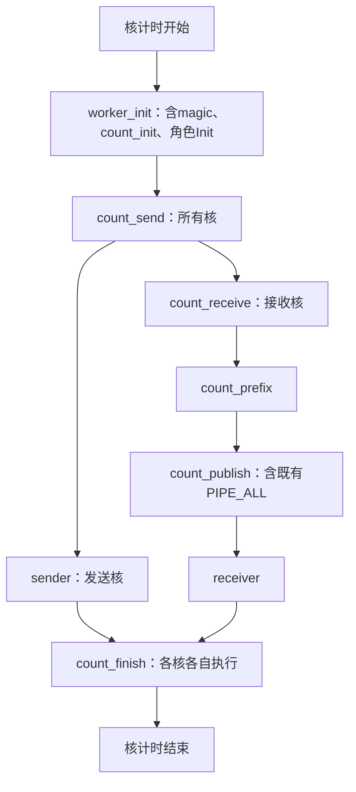

# LL阶段先后关系与核总耗时对账

适用本分支协议10，源码核对基点`b324fbe`。本页解释实际打点，不修改kernel或采样。
先确认运行模式：`one_click.sh`默认`timer`；`--mode reference`是另一套仅dispatch的29阶段格式。
两者边界不同，不能把同名列直接互换。CSV列名以下用代码形式表示。

**所有耗时列不是一组互斥分段，不能整行SUM。** 核总耗时本身是一个外层区间；
主阶段包含子阶段，子阶段还可能包含更细阶段。同一段时间因此会出现多次。
发送核、接收核又是并行的，跨核相加得到的是累计工作量，不是一次kernel延迟。
没有提供具体测量文件，本页给出结构性解释和逐行核验方法，不据此断定某份数据完全没有异常。

## 1. 先统一计算口径

一次对账必须固定同一个run、case、算子、rank、core、capture轮次，使用`stages.csv`或“逐核耗时”页。
`stages_mean.csv`是多轮有效记录均值；不同阶段可能有不同有效轮数，不能直接用它做严格总量对账。
阶段的p90/p99/max也可能来自不同轮或不同核，不能把各列的这些统计值相加。

| 量 | 计算与用途 |
|---|---|
| timer阶段累计值 | `sum_ticks = Σ(end_i-start_i)`；转微秒为`ticks × 1e6 / frequency_hz` |
| timer重复阶段首尾跨度 | `last_end-first_start`包含各次执行之间的间隙，不等于累计值；不能代替CSV耗时 |
| reference区间 | 同核两个word的整数差，再换算单位；w33/w34直接是累计ticks |
| `kernel` | 此核被总计打点包住的时间；不是所有列的和 |
| `before_finalize` | reference另一种总计口径，包含kernel结束至诊断Finish入口；不能加到kernel上 |
| profiler task | 独立采样的设备task时间，不等于某个核打点总计，也不能与阶段值相加 |

频率为1GHz时才可用`ticks/1000 = µs`。原始大整数须先整数相减，再换算；
不要将文本uint64先转成Excel浮点数后相减，否则可能丢掉小差值。
空白表示未记录/不适用；实际执行得到0与空白不同。只有根据对应执行路径确认未执行的可选阶段，
才能在该路径的代数式中省略，不能把缺失的必需记录当作0。

## 2. 默认timer：dispatch顺序与层级

下图表示单核程序顺序。S/R两条分支由不同核并行执行，不是先发完所有payload再开始接收。



图中汇合只是画法，**不是新增跨核同步点**。核的分工按实际AIV前半S/后半R；
某核进入下一阶段不表示其他核也已到达该阶段。

| 层级/范围 | 阶段 | 包含与先后 |
|---|---|---|
| 总计 | `kernel` | 包含下述主阶段及未单独命名的区间 |
| 主阶段 | `worker_init` | 内部依次包含`magic`、`count_init`，以及sender/receiver Init等代码 |
| 主阶段 | `count_send` | worker_init之后，全部核执行 |
| S主阶段 | `sender` | 内部依次执行`send_prepare` → `send_payload` → `send_metadata`；空任务可提前返回 |
| R主阶段 | `count_receive` → `count_prefix` → `count_publish` | 顺序执行；count_publish含CompleteCumsum及其后PIPE_ALL |
| R主阶段 | `receiver` | 内部为准备 → 多批轮询/消费 → 清理 |
| 主阶段 | `count_finish` | S/R本核分支结束后，包含最后PIPE_ALL和CTRL恢复 |

### 2.1 发送内部：哪些列重复

| 父范围 | 细分列 | 解释 |
|---|---|---|
| `sender` | `send_prepare` | UB、lane、路由、初始flags等准备 |
| `sender` | `send_payload` | packet调度，含输入复用收尾及最后一批RDMA Flush |
| `sender` | `send_metadata` | lane归还、source mask/weights写回及MTE3_S |
| `send_payload` | `send_classify` | 去重路由分类；按token重复，非去重路径可能没有 |
| `send_payload` | `send_pack` | 每包构造；包含下方输入/尾部/lane子段及Vector拼包等未细分代码 |
| `send_payload` | `send_issue` | 每包发送提交/入批，以及末尾Flush；按实际调用累计 |
| 通常在`send_pack`内 | `send_input_gm_to_ub` | 输入DataCopy及入队等提交区间，不是纯DMA完成时间 |
| 输入复用逻辑 | `send_input_wait` | DeQue、已有MTE2_S或输入复用等待；也可能出现在尾部Finish，不能把该列全部机械归入send_pack |
| `send_pack` | `send_tail` | FillTail |
| `send_pack` | `send_lane_wait` | lane复用等待指令区间 |
| `send_issue` | `send_mte_write` | 本机路径DataCopy提交 |
| `send_issue` | `send_rdma_stage` | 跨机packet复制到注册GM并等待该源就绪 |
| `send_issue` | `send_rdma_body_post` | 协议10中为**整包单WQE put**，旧列名保留，不再是只发body |
| `send_issue` | `send_rdma_body_wait` | quiet/CQ源完成等待；dispatch按批每peer，不是每包独立计时 |
| Packet保留源分支 | `send_rdma_restore` | SDK scratch覆盖后恢复需要保留的packet；批量dispatch通常不走此分支 |
| 历史槽位 | `send_rdma_flag_post`、`send_rdma_flag_wait` | 协议10整包SO路径不再独立发flag，这两列无记录是预期情况 |

因此不能计算`sender + send_payload + send_issue + send_rdma_body_wait`作为发送耗时；
它们是同一段调用栈上逐层包含的观测。低层transport列只在调用者传入timer时记录，
不要将未传timer的relay/combine传输误认为没有通信。

### 2.2 接收内部：多批累计

```text
receiver
  recv_prepare（前缀加载、任务构建；非空任务还有第二段缓冲准备）
  repeat until pending empty:
    recv_wait（连续空扫描直到本批有ready包）
    recv_consume（本批预取、消费、输出、可能转发、移除pending）
  recv_cleanup（lane收尾、清flags、最终PIPE_ALL）
```

`recv_prepare`可能调用两次，CSV已累计；不要再乘calls。
`recv_wait`、`recv_consume`按ready批累计，不是每个packet各一段。
空任务核完成第一段prepare后返回，不进入循环和cleanup。

| `recv_consume`中的子段 | 含义/顺序 |
|---|---|
| `recv_lane_wait` → `recv_gm_to_ub` | IssueLoad中复用lane并提交packet预取 |
| `recv_load_wait` | ConsumeLoaded等待本包MTE2_S |
| `recv_metadata` | 解码/构造输出路由信息，FIRST_HOP还含共享转发准备 |
| `recv_output_wait` | 输出使用的Scalar/MTE依赖等待 |
| `recv_output_write` | token/scale/路由信息写出，可能分多段累计 |
| `recv_forward` | FIRST_HOP转发循环；其他包不执行 |

通常消费顺序是load_wait → metadata → output_wait → output_write → 可选forward；
非去重compact路径先写payload，再处理/写出路由信息，不能强套同一条细分顺序。
预取多个包与消费交错，硬件流水可重叠；上表是程序计时范围，不是互斥硬件占用时间。

### 2.3 timer dispatch如何对账

定义`R = kernel - 主阶段之和`，在**同一单轮同一核**计算：

```text
S核主阶段和 = worker_init + count_send + sender + count_finish
R核主阶段和 = worker_init + count_send + count_receive
              + count_prefix + count_publish + receiver + count_finish
kernel = 主阶段和 + R
```

这里**不再加magic、count_init或sender/receiver子段**。
R覆盖kernel起点到worker_init前的配置读取、阶段之间的分支/打点写入、对象退出等未单独划段区间。
它不是自动可解释为“纯计算”“通信开销”或“调度空洞”的新指标。
按当前同核顺序区间，未舍入的合法记录应有非负R；微小负数先查显示舍入，明显负数查混轮、混核、
重复父子阶段、错误列或不匹配源码。不能把负值强制截成0掩盖问题。

同理，可计算`sender - (send_prepare + send_payload + send_metadata)`，
以及`receiver - (recv_prepare + recv_wait + recv_consume + recv_cleanup)`，
但须根据空任务路径省略未执行段。子段与父段不共享同一次clock边界，仍存在记录和控制间隙。

## 3. 默认timer：combine

combine的`magic`与`worker_init`是**顺序同级**，这点和dispatch不同：

```text
kernel
  magic → worker_init
  [去重时] combine_prepare
  S核: combine_direct
  R核去重: [部分核] combine_notify → combine_wait_ready
           → combine_partial → combine_aggregate → combine_drain
  R核非去重: combine_aggregate
  combine_final_drain
```

| 阶段 | 意义 |
|---|---|
| `combine_prepare` | 去重路径准备/发布本地待归约行；S/R核均进入对应函数 |
| `combine_notify` | 只有通知核执行ready通知提交 |
| `combine_wait_ready` | 接收/归约核等待组内ready |
| `combine_direct` | S核DIRECT结果回传 |
| `combine_partial` | R核读取成员结果、局部归约和partial回传 |
| `combine_aggregate` | 源token最终加权聚合；非去重是M6路径 |
| `combine_drain` | 去重聚合后DrainSharedOutputs |
| `combine_final_drain` | 本核末尾PIPE_ALL，退休在途操作 |

对账从`magic + worker_init`开始，只加本核实际分支的上述同级combine阶段，最后加`combine_final_drain`；
与kernel之差仍为未覆盖区间。不能把其他核的DIRECT、partial、aggregate全部加在本核上。
旧stage格式同时包含dispatch和combine的所有标签，空白列不意味着此核漏做了必需工作。

## 4. reference：29阶段的先后与精确区间

这里只包含dispatch。记`wN`为同核“原始Cycle”的word N，所有式子先按整数ticks算，再统一换算。
本节主阶段边界比timer细，不能把timer的`count_publish`直接当成reference的`count_complete`。

| 顺序 | 阶段 | 原始区间 |
|---|---|---|
| 公共1 | `entry_config` | w1−w0 |
| 公共2 | `init_prepare` | w2−w1 |
| 公共3 | `magic` | w3−w2 |
| 公共4 | `count_init` | w4−w3 |
| 公共5 | `role_init` | w5−w4 |
| 公共6 | `count_send` | w7−w6 |
| S分支 | `sender` | w9−w8 |
| R分支1 | `count_receive` | w11−w10 |
| R分支2 | `count_prefix` | w13−w12 |
| R分支3 | `count_complete` | w15−w14 |
| R分支4 | `count_drain` | w17−w16 |
| R分支5 | `receiver` | w19−w18 |
| 公共末尾 | `final_drain` | w21−w20 |
| 总计 | `kernel` | w21−w0 |
| 另一总计 | `before_finalize` | w57−w0 |

前五段连续衔接，后续阶段起止点之间有小间隙。因此精确对账为：

```text
I = entry_config + init_prepare + magic + count_init + role_init

S核: kernel = I + count_send + sender + final_drain + Gs
Gs(ticks) = (w6-w5) + (w8-w7) + (w20-w9)

R核: kernel = I + count_send + count_receive + count_prefix
             + count_complete + count_drain + receiver + final_drain + Gr
Gr(ticks) = (w6-w5) + (w10-w7) + (w12-w11) + (w14-w13)
            + (w16-w15) + (w18-w17) + (w20-w19)

before_finalize = kernel + (w57-w21) / 每微秒ticks数
```

最后一式以µs表示；其余若使用CSV值则G也要换算到相同单位。
Gs/Gr是实际边界间隙之和，包含标记写入和边界代码，不是新增加的网络等待。
kernel不含最终诊断身份/有效位发布及cache写回，before_finalize也没有覆盖整个诊断导出。
两者都不是OFF profiler task。

### 4.1 reference细分表：只展开父段，不重复加入主阶段和

| 父段 | 细分 | 区间/关系 |
|---|---|---|
| `count_receive` | `count_ready_poll` | w25−w24；ready轮询，不含全部归约工作 |
| `count_prefix` | `cumsum_join` | w27−w26；跨核汇合/清理提交，不含全部前缀发布 |
| `count_complete` | `prefix_ready` | w29−w28；等待前缀，不含全部加载/输出 |
| `sender` | `send_buffers_routes` | w38−w8 |
| `sender` | `send_packets` | w39−w38 |
| `sender` | `send_drain_metadata` | w40−w39；含尾批Flush，和timer的send_payload边界不同 |
| `receiver` | `recv_prefix_load` | w30−w18 |
| `receiver` | `recv_tasks` | w31−w30 |
| `receiver` | `recv_buffers` | w32−w31，非空任务核 |
| `receiver` | `recv_loop_clear` | w35−w32；整个循环及lane等待/清flags提交 |
| `receiver` | `recv_final_drain` | w36−w35 |
| `recv_loop_clear`内部 | `recv_packet_poll` | w33，按ready批累计轮询 |
| `recv_loop_clear`内部 | `recv_load_consume` | w34，按ready批累计加载/消费提交 |
| 与首次轮询重叠 | `recv_first_packet` | w42−w32；从缓冲准备完至第一批ready，不是额外独立阶段 |

对有任务且上述点有效的核：

```text
sender = send_buffers_routes + send_packets + send_drain_metadata
         + (w9-w40)/每微秒ticks数

receiver = recv_prefix_load + recv_tasks + recv_buffers
           + recv_loop_clear + recv_final_drain
           + (w19-w36)/每微秒ticks数
```

`recv_packet_poll + recv_load_consume`是loop_clear内部分累计，不能再和loop_clear相加。
两项之和不必等于loop_clear：还留有循环边界、初始准备后的间隙、lane收尾和清flags等代码。
`recv_first_packet`与首次poll大幅重叠，但起点不同，不应当作poll累计之外的新等待，
也不应武断断言它精确等于第一次poll。
空任务核缺少w32/w35/w36等点时，不能使用非空公式；接收可按
`recv_prefix_load + recv_tasks + (w19-w31)/每微秒ticks数`对账。
空发送核同理，缺少w38..w40时保留sender父段，不补造子段。

## 5. 如何判断“阶段总和大于核总耗时”

1. 固定单轮同核，先从求和范围中移除`kernel`、`before_finalize`这类总计列。
2. 按上述主阶段清单计算，父段存在时不再加它的子段。dispatch的worker_init/magic尤其容易重复。
3. 计算核总耗时减主阶段和，保留正负原值；reference还可用word间隙公式直接核对。
4. 针对占比最大的父段，只在该父段内部展开一次子段；循环累计值使用total，不使用first到last跨度，不再乘calls。
5. 若同级单轮总和仍明显超过kernel，核对实际源码、模式、schema、单位和原始记录，不先归因计时器错误或性能退化。

例如（仅演示算术，非测量结果）：kernel=100µs，互斥主阶段和=95µs，未覆盖区间=5µs。
其中sender=60µs，子段prepare/payload/metadata=5/50/4µs，sender内部余量=1µs。
若把这三个子段又加入主阶段和，得到154µs，大于100µs；这正是重复计入59µs，而非kernel实际用了154µs。

同rank所有核完成才结束整个kernel，但`max(各核跨度)`只是最长单核诊断指标：
核启动时差、外层task边界和诊断导出均可能使其与profiler task不同。
不要跨核或跨rank相减未对齐时间戳，也不要用“每阶段取最慢核，再相加”拼一个不存在的核。

## 6. 源码对应位置

- [dispatch入口与worker_init范围](../../csrc/kernels/dispatch/low_latency/dispatch_variant_kernel.h)
- [dispatch主阶段顺序](../../csrc/kernels/dispatch/low_latency/dispatch_server_dedup_kernel.h)
- [sender细分与尾Flush](../../csrc/kernels/dispatch/low_latency/device/dispatch_server_dedup_send.h)
- [receiver循环与子段](../../csrc/kernels/dispatch/low_latency/device/dispatch_server_dedup_recv.h)
- [combine入口](../../csrc/kernels/combine/low_latency.cpp)、[combine阶段分支](../../csrc/kernels/combine/low_latency/combine_server_dedup_kernel.h)
- [timer累计实现](../../csrc/kernels/dispatch/low_latency/common/ll_stage_timer_device.h)
- [reference 29阶段定义、有效位与解析](../../deep_ep/utils/ll_reference_profile_parse.py)
- [整包SO批处理](../../csrc/kernels/dispatch/low_latency/device/ll_dispatch_rdma_batch.h)

observe不添加阶段边界屏障；drain会在Start/End处额外PIPE_ALL，改变原本的流水重叠。
以上代数关系解释同次诊断记录，不能把ON或drain耗时当作未插桩OFF开销。
