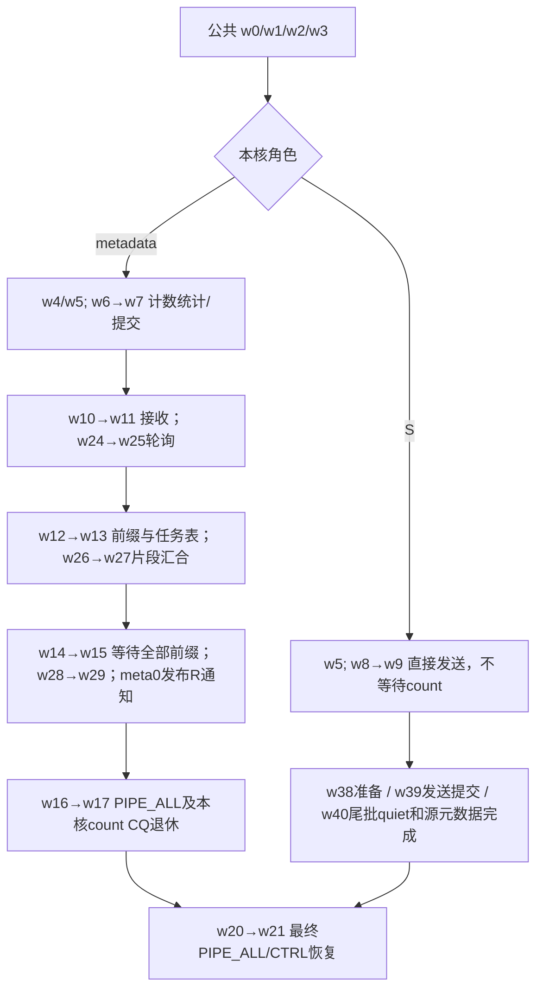
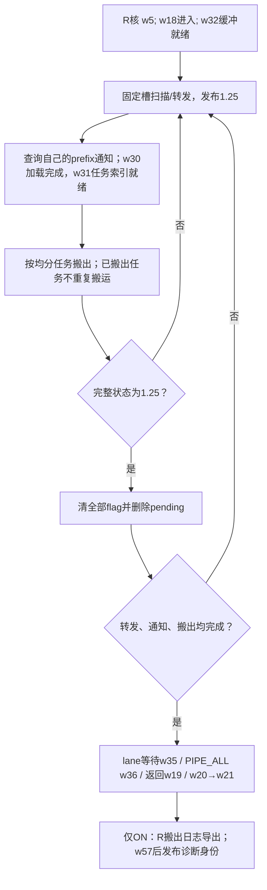

# metadata分支 LL dispatch阶段表（schema5）

当前实现见 [METADATA_CORES.md](METADATA_CORES.md)。仅dispatch支持reference；combine无设备打点。每核80×8=640个uint64，实际AIV核数动态查询；默认4个元数据核，其余平分S/R。

Mark取本核clock并存GM；Value存累计或计数。w62=M，w63=角色。整数差分后按显式频率换算，1GHz为ticks/1000。空白是无效，零是已执行。各核/rank时钟独立，父子/并行阶段不可求和；提交不等于完成。w21不含末尾诊断导出与身份发布，w57包括此前导出但不含Finish随后发布。

每个等待区间只取一次起点clock，空扫描不重复打点；有可接管/搬出/清理批次后取就绪末点和处理末点。w33跨交替扫描/prefix查询，w41统计成功批次；尾部没有成功批次的扫描只在父阶段中体现。w42复用首次就绪末点。R可在零搬出任务时执行转发。w108单独统计有新搬出任务的批次，R明细不充当转发核日志。schema4与schema5不可混作同条件诊断。

## 阶段定义

| 名称 | 公式（1GHz） | 边界 | 层级 |
|---|---|---|---|
| `kernel` / 核总耗时 | `(w21-w0)/1000` | 核入口至最终 PIPE_ALL/CTRL 恢复完成；包含区间内打点开销，不含末尾诊断身份/有效位发布及 cache 写回 | 主阶段 |
| `before_finalize` / 写出前总耗时 | `(w57-w0)/1000` | 核入口至诊断 Finish 开始；包含此前主点 scalar GM 写入，不含随后身份/有效位发布及 cache 写回 | 总计 |
| `entry_config` / 入口配置 | `(w1-w0)/1000` | 入口配置和 tracer 初始化 | 主阶段 |
| `init_prepare` / Init 准备 | `(w2-w1)/1000` | kernel Init 绑定至 magic 开始 | 主阶段 |
| `magic` / magic | `(w3-w2)/1000` | 窗口 magic 轮转，沿用原 DMA/事件/TPipe Reset | 主阶段 |
| `count_init` / 计数 Init | `(w4-w3)/1000` | 计数参数、控制区、CTRL 配置 | 主阶段 |
| `role_init` / 角色 Init | `(w5-w3)/1000` | sender/receiver Init 和布局计算 | 主阶段 |
| `count_send` / 计数统计/发送提交 | `(w7-w6)/1000` | SendCnt，包含已有同步，远端写可异步继续 | 主阶段 |
| `sender` / 发送 payload/元数据完成 | `(w9-w8)/1000` | Sender.Process，结束已有 MTE3_S 等待 | 发送主阶段 |
| `count_receive` / 计数接收/归约 | `(w11-w10)/1000` | RecvCnt，包含 ready 轮询及归约；普通路径在此清计数标记，NDR packed-count 路径随后在 CalcCumsum 中清理 | 接收主阶段 |
| `count_prefix` / cumsum 汇合/发布提交 | `(w13-w12)/1000` | CalcCumsum，包含 GetCumSum 和前缀发布；NDR packed-count 清计数标记位于 GetCumSum 返回后，不计入其子段 | 接收主阶段 |
| `count_complete` / 前缀就绪/加载/输出提交 | `(w15-w14)/1000` | CompleteCumsum，输出计数仍可异步继续 | 接收主阶段 |
| `count_drain` / 计数阶段 drain | `(w17-w16)/1000` | 现有 PIPE_ALL，回收计数 UB 前完成写入 | 接收主阶段 |
| `receiver` / 接收 payload 完成 | `(w19-w18)/1000` | Receiver.Process，含构建任务、轮询、接收及收尾 | 接收主阶段 |
| `final_drain` / 最终 drain/恢复 CTRL | `(w21-w20)/1000` | Counts.Finish，包含现有 PIPE_ALL | 主阶段 |
| `count_ready_poll` / 计数 ready 轮询 | `(w25-w24)/1000` | WaitDispatch 轮询至最后一次 V_S 完成 | 计数接收/归约的细分 |
| `cumsum_join` / cumsum 跨核等待/清理提交 | `(w27-w26)/1000` | GetCumSum，包含等待片段总数和清标记提交 | cumsum 汇合/发布提交的细分 |
| `prefix_ready` / 前缀 ready 等待/清理提交 | `(w29-w28)/1000` | WaitCumSumFlag 等待及清理提交 | 前缀就绪/加载/输出提交的细分 |
| `recv_prefix_load` / 扫描至前缀加载 | `(w30-w32)/1000` | 缓冲准备后交替转发/查询通知，至前缀与均分描述符加载完成；与转发累计重叠 | 接收 payload 完成的细分 |
| `recv_tasks` / 接收任务构建 | `(w31-w30)/1000` | 加载元数据核生成的槽位表并构造本核pending索引 | 接收 payload 完成的细分 |
| `recv_buffers` / 接收缓冲准备 | `(w32-w18)/1000` | 探测、lane、标记缓冲和事件准备 | 接收 payload 完成的细分 |
| `recv_packet_poll` / packet 就绪轮询累计 | `w33/1000` | 一次等待起点至可接管/搬出/清理批次；跨空扫描和prefix查询，空扫描不重复读clock | 接收 payload 完成的细分 |
| `recv_load_consume` / 加载/消费提交累计 | `w34/1000` | 就绪批次的接管/转发或搬出/清理累计 | 接收 payload 完成的细分 |
| `recv_loop_clear` / 接收循环/清标记提交 | `(w35-w32)/1000` | 包含 packet 循环、lane 等待指令和 ClearFlags 提交 | 接收 payload 完成的细分 |
| `recv_final_drain` / 接收最终 PIPE_ALL | `(w36-w35)/1000` | 接收输出、转发及标记清理的现有完成屏障 | 接收 payload 完成的细分 |
| `send_buffers_routes` / 发送缓冲/路由加载 | `(w38-w8)/1000` | Sender UB/lane 分配及路由加载，含已有同步 | 发送 payload/元数据完成的细分 |
| `send_packets` / 路由/packet 发送提交 | `(w39-w38)/1000` | SendWithDedup / SendWithoutDedup，包含已有 lane 依赖 | 发送 payload/元数据完成的细分 |
| `send_drain_metadata` / 发送 drain/元数据完成 | `(w40-w39)/1000` | 尾 RDMA batch Flush（消息完成quiet）、lane 回收、source metadata 写回及已有 MTE3_S；无尾批次时不执行 Flush | 发送 payload/元数据完成的细分 |
| `recv_first_packet` / 首次 packet 就绪等待 | `(w42-w32)/1000` | 接收缓冲准备完至首个 packet batch ready | 接收 payload 完成的细分 |

## 原始word

| word | 名称 |
|---|---|
| w0 | `kernel_entry` |
| w1 | `config_ready` |
| w2 | `magic_begin` |
| w3 | `magic_end` |
| w4 | `counts_init_end` |
| w5 | `role_init_end` |
| w6 | `send_count_begin` |
| w7 | `send_count_issue_end` |
| w8 | `sender_begin` |
| w9 | `sender_end_after_MTE3_S` |
| w10 | `recv_count_begin` |
| w11 | `recv_count_end` |
| w12 | `cumsum_begin` |
| w13 | `cumsum_issue_end` |
| w14 | `complete_cumsum_begin` |
| w15 | `complete_cumsum_issue_end` |
| w16 | `count_drain_begin` |
| w17 | `count_drain_end_PIPE_ALL` |
| w18 | `receiver_begin` |
| w19 | `receiver_end` |
| w20 | `final_drain_begin` |
| w21 | `final_drain_end_PIPE_ALL` |
| w22 | `reserved` |
| w23 | `reserved` |
| w24 | `count_ready_poll_begin` |
| w25 | `count_ready_poll_end_after_V_S` |
| w26 | `cumsum_peer_join_begin` |
| w27 | `cumsum_peer_join_clear_issue_end` |
| w28 | `prefix_ready_wait_begin` |
| w29 | `prefix_ready_wait_clear_issue_end` |
| w30 | `receive_prefix_loaded_after_MTE2_S` |
| w31 | `receive_tasks_built` |
| w32 | `receive_buffers_ready` |
| w33 | `receive_packet_poll_accum_cycles` |
| w34 | `receive_load_consume_submit_accum_cycles` |
| w35 | `receive_lane_wait_clear_issue_end` |
| w36 | `receive_final_PIPE_ALL_end` |
| w37 | `receive_task_count` |
| w38 | `send_buffers_routes_ready` |
| w39 | `send_packets_issue_end` |
| w40 | `send_metadata_end_after_MTE3_S` |
| w41 | `receive_probe_batch_count` |
| w42 | `first_packet_ready` |
| w43 | `send_route_count` |
| w44 | `reserved` |
| w45 | `reserved` |
| w46 | `reserved` |
| w47 | `reserved` |
| w48 | `reserved` |
| w49 | `reserved` |
| w50 | `rank` |
| w51 | `AIV_core` |
| w52 | `EP` |
| w53 | `active_aiv` |
| w54 | `BS` |
| w55 | `schema` |
| w56 | `operation` |
| w57 | `before_finalize` |
| w58 | `valid_mask` |
| w59 | `magic` |
| w60 | `boundary_mode` |
| w61 | `complete` |
| w62 | `metadata_cores` |
| w63 | `core_role` |
| w64 | `packet_detail_version` |
| w65 | `send_remote_packets` |
| w66 | `send_group_packets` |
| w67 | `remote_first_begin` |
| w68 | `remote_last_put_return` |
| w69 | `group_first_begin` |
| w70 | `group_last_submit_return` |
| w71 | `second_remote_begin` |
| w72 | `second_remote_enqueue` |
| w73 | `second_remote_put_begin` |
| w74 | `second_remote_put_return` |
| w75 | `second_remote_member_q_ticks` |
| w76 | `second_remote_token` |
| w77 | `second_remote_k` |
| w78 | `second_remote_expert` |
| w79 | `second_remote_peer` |
| w80 | `batch_quiet_ticks` |
| w81 | `batch_flush_count` |
| w82 | `last_quiet_end` |
| w83 | `second_remote_triggered_flush` |
| w84 | `remote_first_order` |
| w85 | `remote_last_order` |
| w86 | `group_first_order` |
| w87 | `group_last_order` |
| w88 | `send_packet_count` |
| w89 | `send_lanes` |
| w90 | `second_stage_queued` |
| w91 | `second_stage_wait_begin` |
| w92 | `second_stage_wait_end` |
| w93 | `deferred_remote_packets` |
| w94 | `second_previous_submit_ticks` |
| w95 | `second_post_deferred` |
| w96 | `recv_trace_rows` |
| w97 | `recv_trace_capacity` |
| w98 | `recv_trace_total_tasks` |
| w99 | `recv_trace_ready_seen` |
| w100 | `recv_trace_processed_seen` |
| w101 | `recv_trace_lanes` |
| w102 | `recv_trace_export_begin` |
| w103 | `recv_trace_export_end` |
| w104 | `recv_trace_row_begin` |
| w105 | `recv_trace_bs` |
| w106 | `recv_trace_local_experts` |
| w107 | `recv_trace_truncated` |
| w108 | `output_ready_batches` |
| w109 | `detail_reserved` |
| w110 | `detail_reserved` |
| w111 | `detail_reserved` |
| w112 | `detail_reserved` |
| w113 | `detail_reserved` |
| w114 | `detail_reserved` |
| w115 | `detail_reserved` |
| w116 | `detail_reserved` |
| w117 | `detail_reserved` |
| w118 | `detail_reserved` |
| w119 | `detail_reserved` |
| w120 | `detail_reserved` |
| w121 | `detail_reserved` |
| w122 | `detail_reserved` |
| w123 | `detail_reserved` |
| w124 | `detail_reserved` |
| w125 | `detail_reserved` |
| w126 | `detail_reserved` |
| w127 | `detail_reserved` |

w128～639为最多128条搬出任务日志，每条32B；仅有余量UB时记录，不减少业务lane。原始uint64使用文本保精度。
