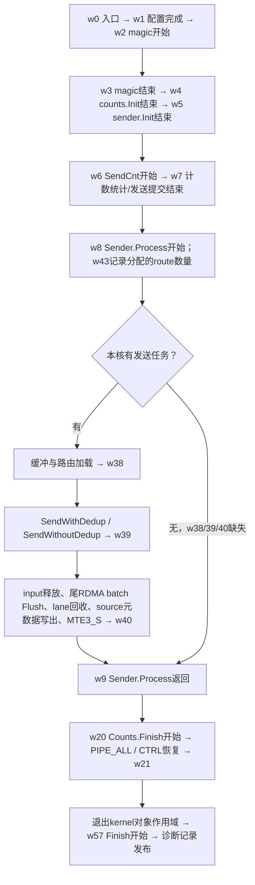
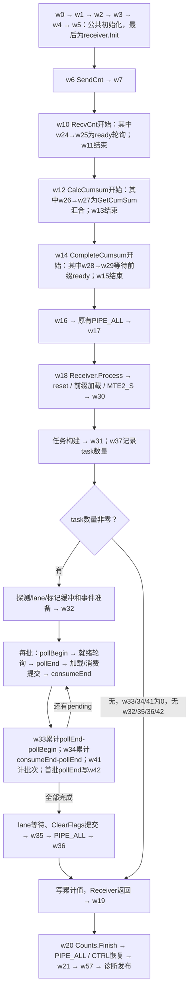

# LL dispatch 打点顺序与 Excel 耗时对应

## 1. 当前唯一打点方式

当前 kernel 只保留 `DEEPEP_LL_REFERENCE_PROFILE`，只采集 LL dispatch；旧 stage/expert device 插桩已删除，combine 不再有设备打点。`one_click.sh` 默认 `reference`，`--mode perf` 为无插桩性能测试。旧 `--mode timer` 不再接受；历史结果仍可离线解析。

`wN` 是本核 64 个 uint64 record word 中的索引，不是名为 W 的 C++ 变量。源码的 `Mark<N>()` 取一次 clock 并写 word N，`Value<N>(value)` 写指定值；现在每个调用旁都可搜索 `wN:`。w0 的取时在入口，稍后写入；w42 复用首批 pollEnd，不额外读 clock。每核 512B，实际 AIV 数动态查询，前半为 S，后半为 R。

同核原始整数先相减再换算。1GHz 时除以1000得到微秒。空白表示该点未执行/无效，0表示有效的零值。w33、w34为累计周期，w37、w41、w43为数量，不能拿它们作时间戳相减。

## 2. 当前 reference：dispatch 顺序与层级

以下为每个核自己的程序顺序。S/R 并行工作，不能将两张图串行相加；数字是 word 索引，不代表执行先后。图中“提交”也不代表异步写已经完成。

### 2.1 S 核

`sender = w9-w8` 包含三段 `w38-w8`、`w39-w38`、`w40-w39`，还包含 `w9-w40` 的返回间隙。w39之前的发送循环可能已经执行满批次 Flush；最后未满的 RDMA 批次在 w39→w40 中完成。w43为分配的逻辑路由数量，不能当作去重后实际网络包数。

### 2.2 R 核

计数任务分配与 payload 任务分配不同；w24/25、w26/27、w28/29是按实际执行路径出现的可选成对点，不能由 w37 推断其必然存在。每个 ready 批次只有三个 clock，空扫描和逐 packet 没有额外打点。w33/w34覆盖循环内的两个累计区间；`w35-w32`还包括循环管理、打点开销、lane回收和清标记提交。`w42-w32`是首批等待，已经包含在整个接收循环中，不能再加一次。

### 2.3 各个 word 的定义与源码

| Word | 内容 / 边界 | 类型 |
|---|---|---|
| w0 | `kernel_entry` | 时间戳 |
| w1 | `config_ready` | 时间戳 |
| w2 | `magic_begin` | 时间戳 |
| w3 | `magic_end` | 时间戳 |
| w4 | `counts_init_end` | 时间戳 |
| w5 | `role_init_end` | 时间戳 |
| w6 | `send_count_begin` | 时间戳 |
| w7 | `send_count_issue_end` | 时间戳 |
| w8 | `sender_begin` | 时间戳 |
| w9 | `sender_end_after_MTE3_S` | 时间戳 |
| w10 | `recv_count_begin` | 时间戳 |
| w11 | `recv_count_end` | 时间戳 |
| w12 | `cumsum_begin` | 时间戳 |
| w13 | `cumsum_issue_end` | 时间戳 |
| w14 | `complete_cumsum_begin` | 时间戳 |
| w15 | `complete_cumsum_issue_end` | 时间戳 |
| w16 | `count_drain_begin` | 时间戳 |
| w17 | `count_drain_end_PIPE_ALL` | 时间戳 |
| w18 | `receiver_begin` | 时间戳 |
| w19 | `receiver_end` | 时间戳 |
| w20 | `final_drain_begin` | 时间戳 |
| w21 | `final_drain_end_PIPE_ALL` | 时间戳 |
| w24 | `count_ready_poll_begin` | 时间戳 |
| w25 | `count_ready_poll_end_after_V_S` | 时间戳 |
| w26 | `cumsum_peer_join_begin` | 时间戳 |
| w27 | `cumsum_peer_join_clear_issue_end` | 时间戳 |
| w28 | `prefix_ready_wait_begin` | 时间戳 |
| w29 | `prefix_ready_wait_clear_issue_end` | 时间戳 |
| w30 | `receive_prefix_loaded_after_MTE2_S` | 时间戳 |
| w31 | `receive_tasks_built` | 时间戳 |
| w32 | `receive_buffers_ready` | 时间戳 |
| w33 | `receive_packet_poll_accum_cycles` | 累计周期 |
| w34 | `receive_load_consume_submit_accum_cycles` | 累计周期 |
| w35 | `receive_lane_wait_clear_issue_end` | 时间戳 |
| w36 | `receive_final_PIPE_ALL_end` | 时间戳 |
| w37 | `receive_task_count` | 计数 |
| w38 | `send_buffers_routes_ready` | 时间戳 |
| w39 | `send_packets_issue_end` | 时间戳 |
| w40 | `send_metadata_end_after_MTE3_S` | 时间戳 |
| w41 | `receive_probe_batch_count` | 计数 |
| w42 | `first_packet_ready` | 时间戳 |
| w43 | `send_route_count` | 计数 |
| w50 | `rank` | 身份/有效性元数据 |
| w51 | `AIV_core` | 身份/有效性元数据 |
| w52 | `EP` | 身份/有效性元数据 |
| w53 | `active_aiv` | 身份/有效性元数据 |
| w54 | `BS` | 身份/有效性元数据 |
| w55 | `schema` | 身份/有效性元数据 |
| w56 | `operation` | 身份/有效性元数据 |
| w57 | `before_finalize` | 时间戳 |
| w58 | `valid_mask` | 身份/有效性元数据 |
| w59 | `magic` | 身份/有效性元数据 |
| w60 | `boundary_mode` | 身份/有效性元数据 |
| w61 | `complete` | 身份/有效性元数据 |

源码位置（每个点均有同名注释）：

- [dispatch_variant_kernel.h](../../csrc/kernels/dispatch/low_latency/dispatch_variant_kernel.h)：入口 w0/w1。
- [dispatch_server_dedup_kernel.h](../../csrc/kernels/dispatch/low_latency/dispatch_server_dedup_kernel.h)：主流程 w2..w21。
- [dispatch_server_dedup_counts.h](../../csrc/kernels/dispatch/low_latency/device/dispatch_server_dedup_counts.h)：w24..w29。
- [dispatch_server_dedup_send.h](../../csrc/kernels/dispatch/low_latency/device/dispatch_server_dedup_send.h)：w38..w40、w43。
- [dispatch_server_dedup_recv.h](../../csrc/kernels/dispatch/low_latency/device/dispatch_server_dedup_recv.h)：w30..w37、w41/w42。
- [ll_reference_profile_device.h](../../csrc/kernels/dispatch/low_latency/common/ll_reference_profile_device.h)：w57与元数据发布。

## 3. core_stage_timings.xlsx 每列对应哪一段

每个case的 `core_stage_timings.xlsx` 保留，run级 `stage-times.xlsx` 将各case合为多sheet。逐核耗时默认选择末次capture，每个rank/core一行；多轮均值独立列在均值页/CSV。以下与解析器 `STAGE_INFO` 的29列一一对应；公式以1GHz为例。任务数列S取w43，R取w37。

| CSV阶段 / Excel列名 | 微秒公式 | 覆盖内容 | 层级 |
|---|---|---|---|
| `kernel` / 核总耗时 | `(w21-w0)/1000` | 核入口至最终 PIPE_ALL/CTRL 恢复完成；包含区间内打点开销，不含末尾诊断身份/有效位发布及 cache 写回 | 主阶段 |
| `before_finalize` / 写出前总耗时 | `(w57-w0)/1000` | 核入口至诊断 Finish 开始；包含此前主点 scalar GM 写入，不含随后身份/有效位发布及 cache 写回 | 总计 |
| `entry_config` / 入口配置 | `(w1-w0)/1000` | 入口配置和 tracer 初始化 | 主阶段 |
| `init_prepare` / Init 准备 | `(w2-w1)/1000` | kernel Init 绑定至 magic 开始 | 主阶段 |
| `magic` / magic | `(w3-w2)/1000` | 窗口 magic 轮转，沿用原 DMA/事件/TPipe Reset | 主阶段 |
| `count_init` / 计数 Init | `(w4-w3)/1000` | 计数参数、控制区、CTRL 配置 | 主阶段 |
| `role_init` / 收发 Init | `(w5-w4)/1000` | sender/receiver Init 和布局计算 | 主阶段 |
| `count_send` / 计数统计/发送提交 | `(w7-w6)/1000` | SendCnt，包含已有同步，远端写可异步继续 | 主阶段 |
| `sender` / 发送 payload/元数据完成 | `(w9-w8)/1000` | Sender.Process，结束已有 MTE3_S 等待 | 发送主阶段 |
| `count_receive` / 计数接收/归约 | `(w11-w10)/1000` | RecvCnt，包含 ready 轮询及归约；普通路径在此清计数标记，NDR packed-count 路径随后在 CalcCumsum 中清理 | 接收主阶段 |
| `count_prefix` / cumsum 汇合/发布提交 | `(w13-w12)/1000` | CalcCumsum，包含 GetCumSum 和前缀发布；NDR packed-count 清计数标记位于 GetCumSum 返回后，不计入其子段 | 接收主阶段 |
| `count_complete` / 前缀就绪/加载/输出提交 | `(w15-w14)/1000` | CompleteCumsum，输出计数仍可异步继续 | 接收主阶段 |
| `count_drain` / 计数阶段 drain | `(w17-w16)/1000` | 现有 PIPE_ALL，回收计数 UB 前完成写入 | 接收主阶段 |
| `receiver` / 接收 payload 完成 | `(w19-w18)/1000` | Receiver.Process，含构建任务、轮询、接收及收尾 | 接收主阶段 |
| `final_drain` / 最终 drain/恢复 CTRL | `(w21-w20)/1000` | Counts.Finish，包含现有 PIPE_ALL | 主阶段 |
| `count_ready_poll` / 计数 ready 轮询 | `(w25-w24)/1000` | WaitDispatch 轮询至最后一次 V_S 完成 | 计数接收/归约的细分 |
| `cumsum_join` / cumsum 跨核等待/清理提交 | `(w27-w26)/1000` | GetCumSum，包含等待片段总数和清标记提交 | cumsum 汇合/发布提交的细分 |
| `prefix_ready` / 前缀 ready 等待/清理提交 | `(w29-w28)/1000` | WaitCumSumFlag 等待及清理提交 | 前缀就绪/加载/输出提交的细分 |
| `recv_prefix_load` / 接收前缀加载 | `(w30-w18)/1000` | Receiver reset / 前缀 DMA，结束 MTE2_S | 接收 payload 完成的细分 |
| `recv_tasks` / 接收任务构建 | `(w31-w30)/1000` | ReceiveTasks.Build | 接收 payload 完成的细分 |
| `recv_buffers` / 接收缓冲准备 | `(w32-w31)/1000` | 探测、lane、标记缓冲和事件准备 | 接收 payload 完成的细分 |
| `recv_packet_poll` / packet 就绪轮询累计 | `w33/1000` | 每批完整轮询区间累积，未对每次空扫描插点 | 接收 payload 完成的细分 |
| `recv_load_consume` / 加载/消费提交累计 | `w34/1000` | IssueLoad / ConsumeLoaded / RemovePending 区间累积 | 接收 payload 完成的细分 |
| `recv_loop_clear` / 接收循环/清标记提交 | `(w35-w32)/1000` | 包含 packet 循环、lane 等待指令和 ClearFlags 提交 | 接收 payload 完成的细分 |
| `recv_final_drain` / 接收最终 PIPE_ALL | `(w36-w35)/1000` | 接收输出、转发及标记清理的现有完成屏障 | 接收 payload 完成的细分 |
| `send_buffers_routes` / 发送缓冲/路由加载 | `(w38-w8)/1000` | Sender UB/lane 分配及路由加载，含已有同步 | 发送 payload/元数据完成的细分 |
| `send_packets` / 路由/packet 发送提交 | `(w39-w38)/1000` | SendWithDedup / SendWithoutDedup，包含已有 lane 依赖 | 发送 payload/元数据完成的细分 |
| `send_drain_metadata` / 发送 drain/元数据完成 | `(w40-w39)/1000` | 尾 RDMA batch Flush（消息完成quiet）、lane 回收、source metadata 写回及已有 MTE3_S；无尾批次时不执行 Flush | 发送 payload/元数据完成的细分 |
| `recv_first_packet` / 首次 packet 就绪等待 | `(w42-w32)/1000` | 接收缓冲准备完至首个 packet batch ready | 接收 payload 完成的细分 |

## 4. 为什么阶段相加不等于核总耗时

`kernel=(w21-w0)` 是总区间，`before_finalize=(w57-w0)` 是另一总区间，二者不能相加；父阶段与细分阶段重复覆盖。公共主阶段之间仍有 w5→w6、w7→角色入口以及各函数返回/下个调用之间的间隙。对同一capture、同一核，可以按图中真实顺序插入这些间隙，使所有相邻时间差望远镜求和得到 w21-w0；不能把29列直接SUM。

R核的 `receiver` 包含前缀加载、任务构建、缓冲准备、循环清理、最终drain及函数返回间隙；w33/w34、首次就绪等待都是其中子区间。S核的 sender 三段边界已在2.1说明。未执行的点不能补造时间，必要点缺失由解析器报错。

只在同核做差，不作跨rank/core时钟差。多轮均值、跨核最大值、p99可能各自来自不同样本，也不能用于严格逐段对账。kernel不包含w21之后的全部诊断写出；before_finalize也不包含w57之后的身份/有效位/cache发布。因此这些值都不能替代完整OFF profiler task时间。

## 5. 构建与历史数据

两台目标机拉取同一提交后正常运行 `one_click.sh`，默认重编reference完整wheel；不要对旧wheel使用 `--skip-build`。`--reference-iters N` 控制capture轮数；`--mode perf` 仍测试完整dispatch+BF16 combine。SDK、协议10、launch结构大小、采样协议initial-reduce-exp100-batch-v3保持不变。

旧timer结果仅保留离线解码支持，可用 `one_click.sh --analyze-only RUN_DIR --output-dir NEW_DIR`。历史47阶段不是当前29阶段，不能跨格式直接A/B。
